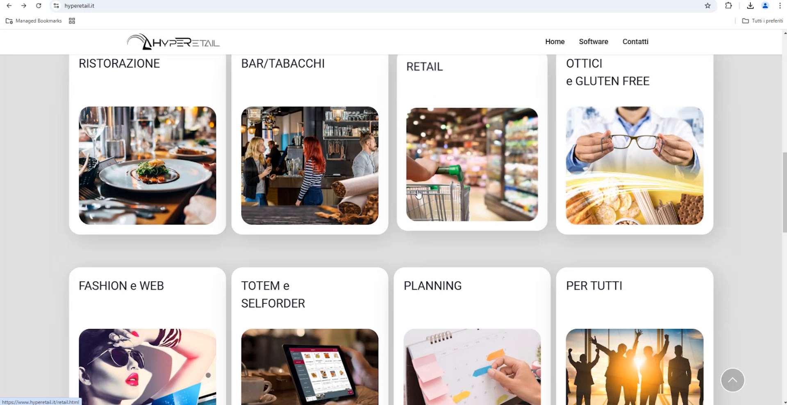

# Panoramica di Hyperetail

**TARGET:** tecnico installatore · **DURATA STIMATA:** 10 minuti

## Obiettivo

Capire cos'è Hyperetail, quali settori copre, su che tecnologia si appoggia e
quali sono i concetti da avere chiari prima di iniziare un'installazione.

## Che cos'è

**Hyperetail** è un software di vendita (interfaccia POS touch) **multipiattaforma,
multisettoriale, multiazienda e multimagazzino**. Con lo stesso software si
meccanizzano attività che vanno dalla ristorazione al retail, dal fashion ai
totem e al self order.

Il **modulo base** è condiviso da tutti i settori: è quello che si scarica
nella prima installazione. Ogni settore merceologico aggiunge poi i propri
**moduli aggiuntivi**, che si collegano al modulo base.

Il portale raggruppa le soluzioni per settore: Ristorazione, Bar/Tabacchi,
Retail, Ottici e Gluten Free, Fashion e Web, Totem e SelfOrder, Planning e
soluzioni per tutti i settori.

## L'ecosistema hardware

Hyperetail permette di costruire un ecosistema con i prodotti hardware Custom:

- stampante telematica (registratore fiscale);
- bilance elettroniche, famiglie **Icona** e **Unica**;
- chioschi;
- terminali per inventario o raccolta dati con palmare (ad esempio per la
  ristorazione).

## Tecnologia e architettura

| Aspetto | Dettaglio |
|---|---|
| Database | **Firebird**; il software è **auto-installante** e installa il database insieme al programma |
| Linguaggio | Delphi |
| Modulo base | Condiviso da tutti i settori merceologici |
| Moduli aggiuntivi | Specifici per settore, si collegano al modulo base |
| Aggiornamenti | Gestiti dall'applicazione **HyperSide** |

## Concetti chiave da tenere presenti

1. **Ogni schermata è legata a un operatore.** Sia le pagine di vendita sia
   quelle di configurazione o gestionali sono associate a un operatore con la
   propria password.
2. **Ogni pagina è personalizzabile.** Tasti, funzioni, colori e aree si
   modificano direttamente dal software, nella *modalità disegno*
   (Disegnatore).
3. **La configurazione di base si concentra in poche tabelle:** reparti,
   anagrafica articoli, parametri di barriera (gruppo POS) e operatori.
4. **Tutte le configurazioni generali** sono raccolte nel menu
   *Configurazioni generali* della pagina di amministrazione.

## Verifica

Prima di proseguire assicurati di sapere rispondere a queste domande:

- Quale software si scarica dal portale per installare Hyperetail? *(HyperSide)*
- Su quale database si appoggia Hyperetail? *(Firebird)*
- Dove si configurano operatori, reparti e articoli? *(Configurazioni generali)*

!!! note "Modalità senza gestionale"
    Hyperetail si abbina normalmente al gestionale **HyperStore**, ma può
    funzionare anche in versione autonoma, senza gestionale. È la versione
    che si installa e si configura in questo percorso: il setup indica
    "versione autonoma senza necessità di gestionale per la configurazione".
