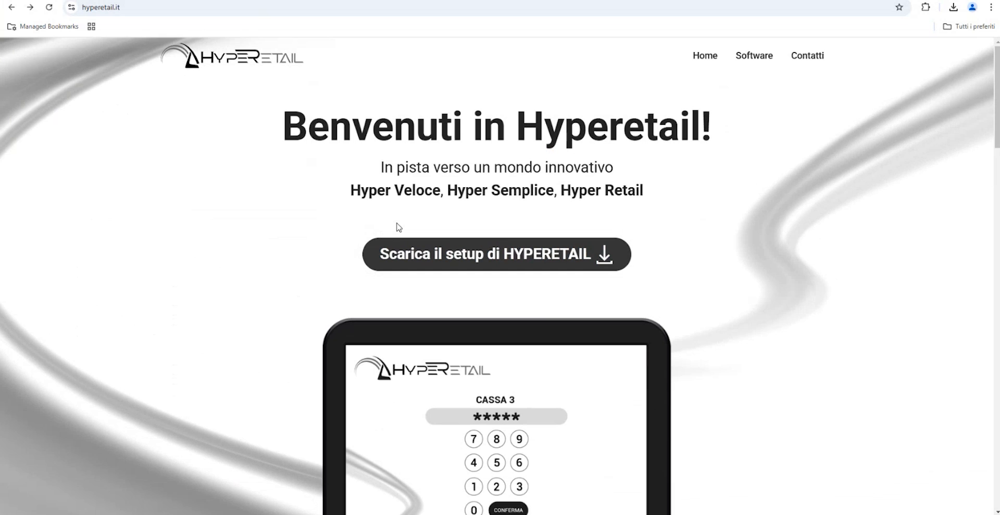
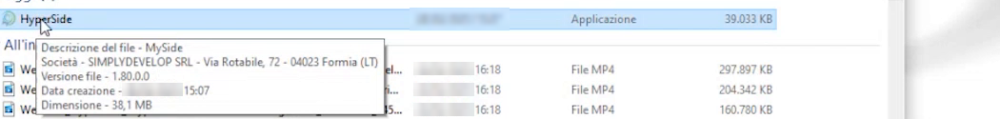
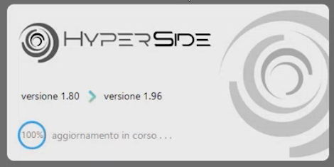
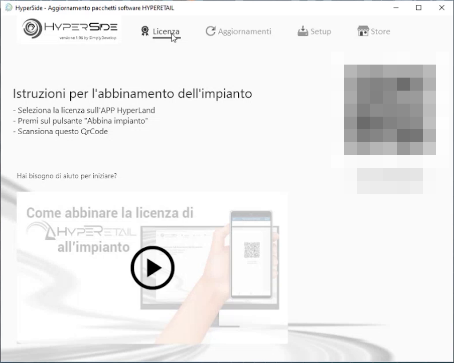
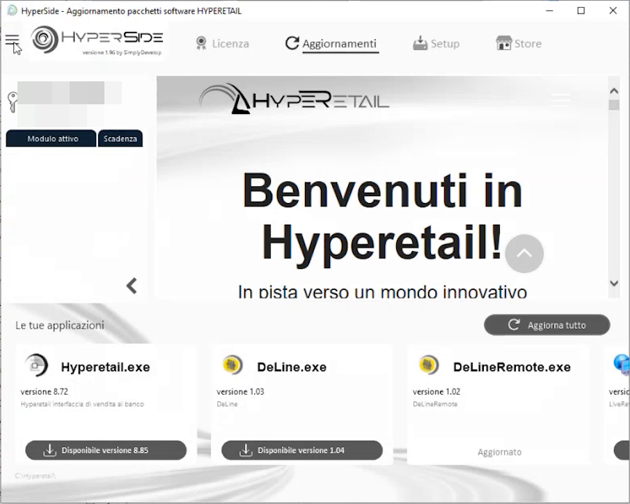

# Download e avvio di HyperSide

**TARGET:** tecnico installatore · **DURATA STIMATA:** 10 minuti

## Obiettivo

Scaricare **HyperSide**, l'applicazione che consente di scaricare, installare e
aggiornare tutti i software dell'ecosistema Hyperetail, e conoscerne le
quattro schede principali.

## Prerequisiti

- PC Windows con connessione a Internet.
- Permessi per autorizzare l'esecuzione di un'applicazione scaricata.

## Passaggi

1. Apri il browser e vai su **www.hyperetail.it**.
2. Dalla home page premi **Scarica il setup di HYPERETAIL**.

    

3. Apri la cartella **Download** del PC: il file scaricato si chiama
   **HyperSide**.

    

4. Avvia **HyperSide** e **autorizza l'esecuzione** dell'applicazione.
5. Attendi l'**aggiornamento automatico**: se esiste una versione più recente
   di HyperSide, l'applicazione si aggiorna da sola prima di aprirsi.

    

## Le schede di HyperSide

HyperSide è la "finestra" su tutti i software installabili nel mondo
Hyperetail e sulle applicazioni collegate. In alto trovi quattro schede.

| Scheda | A cosa serve |
|---|---|
| **Licenza** | Mostra se il software è licenziato e guida all'abbinamento dell'impianto |
| **Aggiornamenti** | Elenca le applicazioni installate, con versione corrente e versione disponibile |
| **Setup** | Elenca le applicazioni disponibili per l'installazione (qui si scarica Hyperetail) |
| **Store** | Catalogo dei moduli disponibili |

### Scheda Licenza

La scheda indica se l'impianto è licenziato. Per abbinare la licenza segui le
istruzioni riportate nella schermata:

1. seleziona la licenza sull'app **HyperLand**;
2. premi **Abbina impianto**;
3. scansiona il **QR code** mostrato da HyperSide.

### Scheda Aggiornamenti

La scheda elenca le applicazioni presenti nella cartella di installazione
(ad esempio Hyperetail, DeLine, DeLineRemote), la versione installata e,
quando disponibile, la versione più recente da scaricare. Il pulsante
**Aggiorna tutto** aggiorna tutte le applicazioni in una volta.

## Verifica

- HyperSide si apre senza errori e mostra le schede **Licenza**,
  **Aggiornamenti**, **Setup** e **Store**.
- Nella scheda **Setup**, in basso, compare l'indicazione che il **servizio
  Firebird è in esecuzione**.

## Attenzioni

!!! note "Autorizzazione dell'esecuzione"
    Al primo avvio Windows può chiedere conferma per eseguire l'applicazione
    scaricata: autorizza l'esecuzione per proseguire.

!!! tip "Gestione delle licenze dei moduli"
    L'abbinamento commerciale delle licenze ai moduli non è trattato in
    questa guida, che si concentra sull'installazione e sulla configurazione.
