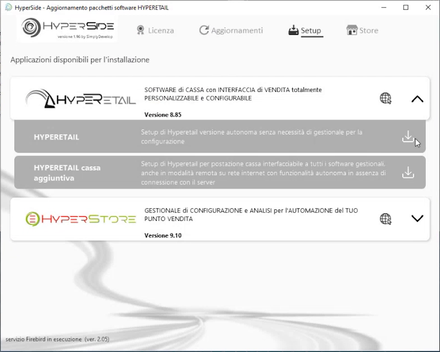
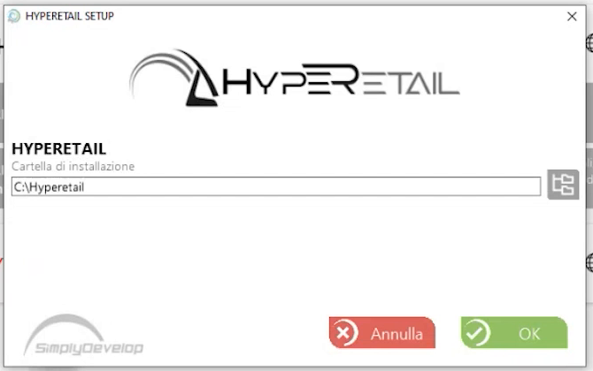
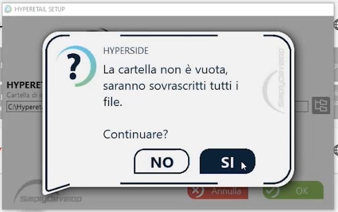
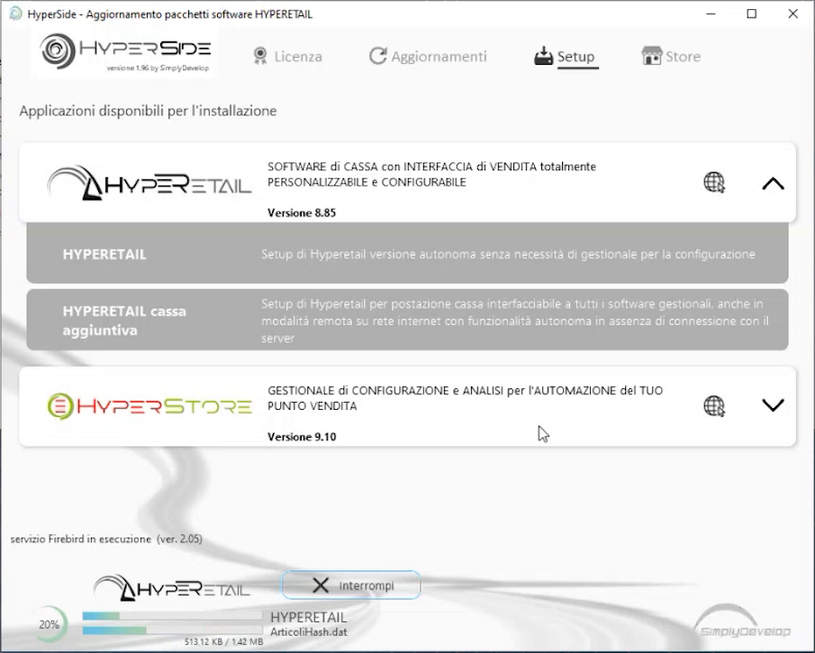
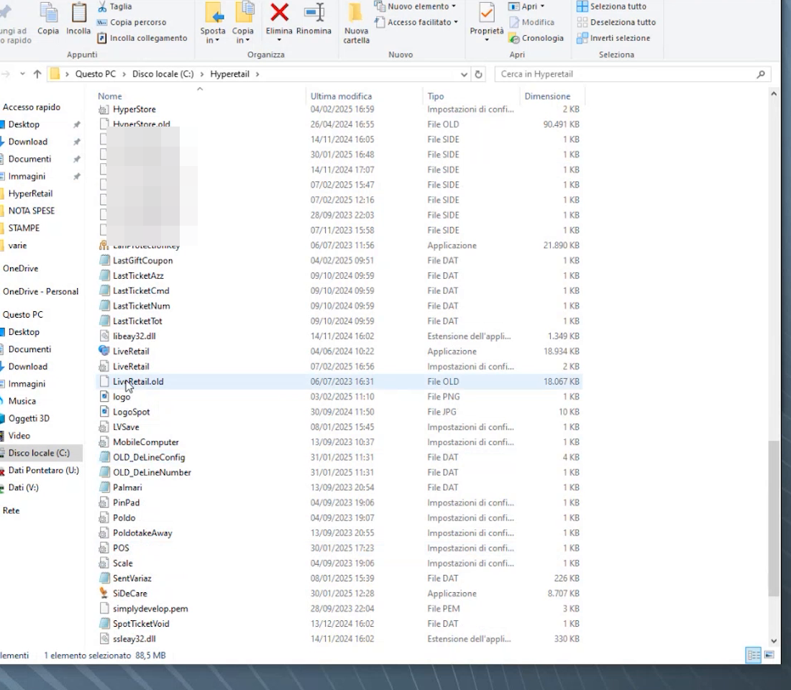
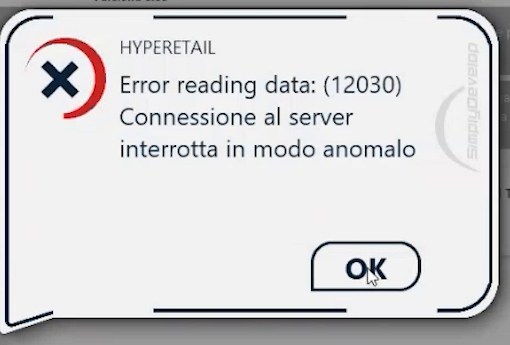

# Installazione di Hyperetail

**TARGET:** tecnico installatore · **DURATA STIMATA:** 15 minuti

## Obiettivo

Installare il modulo base **Hyperetail** dalla scheda **Setup** di HyperSide e
riconoscere il contenuto della cartella di installazione.

## Prerequisiti

- HyperSide installato e aperto (vedi [Download di HyperSide](02-download-hyperside.md)).
- Connessione a Internet stabile: il download dei pacchetti dipende dalla
  connessione e dall'uso che se ne sta facendo in quel momento.

## Quale setup scegliere

Nella scheda **Setup** sono elencate le applicazioni disponibili.

| Setup | Quando usarlo |
|---|---|
| **HYPERETAIL** | Prima installazione: versione autonoma, senza necessità di gestionale per la configurazione |
| **HYPERETAIL cassa aggiuntiva** | Quando serve una **cassa in più**: la postazione fa riferimento a un database e attua una procedura di sincronizzazione con la cassa principale (o con la postazione dove è presente il database). Funziona anche in remoto su rete Internet e in autonomia in assenza di connessione con il server |
| **HYPERSTORE** | Gestionale di configurazione e analisi, il back office |

## Passaggi

1. In HyperSide apri la scheda **Setup**.
2. Premi l'icona di download accanto a **HYPERETAIL**.
3. Nella finestra **HYPERETAIL SETUP** controlla la **cartella di installazione**
   (di default `C:\Hyperetail`) e premi **OK**.

    

4. Se la cartella contiene già file, compare un avviso: leggilo con
   attenzione prima di rispondere.

    

    - **SI** sovrascrive tutti i file presenti nella cartella;
    - **NO** annulla l'operazione.

5. Attendi il download: HyperSide mostra l'avanzamento in basso, con il nome
   del file in corso di scaricamento. Se la connessione è lenta, il tempo
   aumenta.

    

6. Al termine il software è installato. Il database **Firebird** viene
   installato automaticamente insieme al programma.

## La cartella di installazione

Apri `C:\Hyperetail` per riconoscere il contenuto. Oltre a Hyperetail trovi
file e applicazioni per la gestione dei moduli aggiuntivi, ad esempio:

- **HyperStore**, la parte di back office;
- **LiveRetail**, per la connessione delle bilance;
- **WService**, per la nuova parte di Hyperetail;
- i file di configurazione **.ini** (`POS`, `PinPad`, `Palmari`, `Scale`...)
  che userai nell'ultima parte di questo percorso.

## Creare più installazioni (postazioni demo)

Ogni cartella scaricata e configurata contiene un database. Puoi **rinominare**
la cartella per conservare quell'installazione come database dimostrativo e
poi rilanciare il setup sul nome originale per ottenere una nuova
installazione con **database vuoto**. In questo modo puoi creare sul tuo PC
postazioni dimostrative separate.

!!! warning "Verifica sempre l'esito"
    Dopo aver rilanciato il setup su una cartella rinominata controlla che
    l'installazione risulti pulita (database vuoto) prima di iniziare la
    configurazione.

## Verifica

- La cartella `C:\Hyperetail` contiene Hyperetail e i file `.ini`.
- In HyperSide, scheda **Aggiornamenti**, **Hyperetail.exe** compare con la
  versione installata.

## Errori comuni

| Sintomo | Causa e soluzione |
|---|---|
| Messaggio **Error reading data: (12030) - Connessione al server interrotta in modo anomalo** durante il download | La connessione al server di download si è interrotta. Premi **OK** e **ripeti** il setup; l'esito dipende dalla connessione Internet e dalla disponibilità del server |
| Avviso **La cartella non è vuota, saranno sovrascritti tutti i file** | La cartella contiene già un'installazione. Rispondi **SI** solo se vuoi davvero sovrascriverla; altrimenti scegli un'altra cartella |

