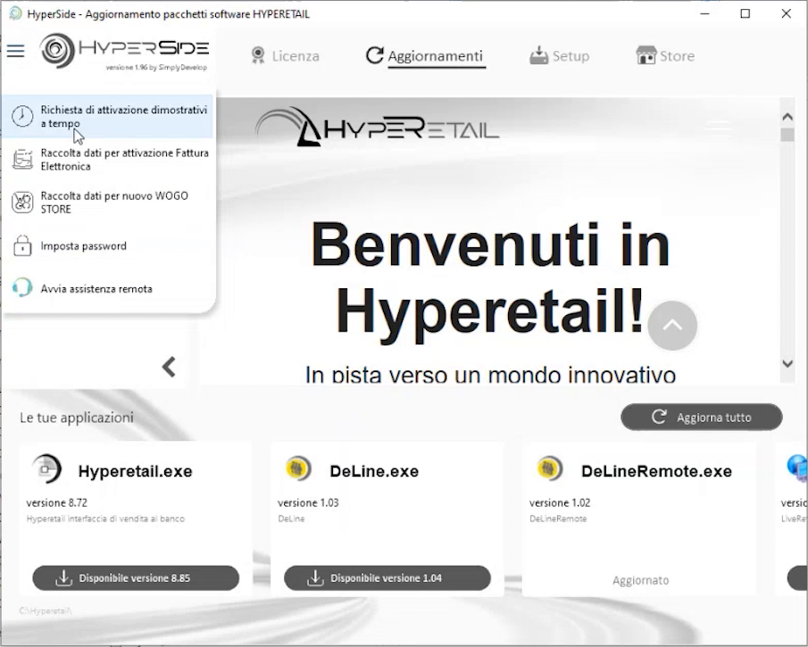
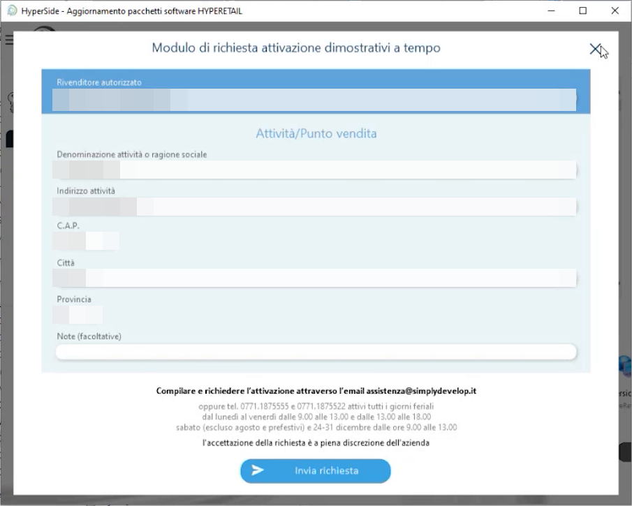
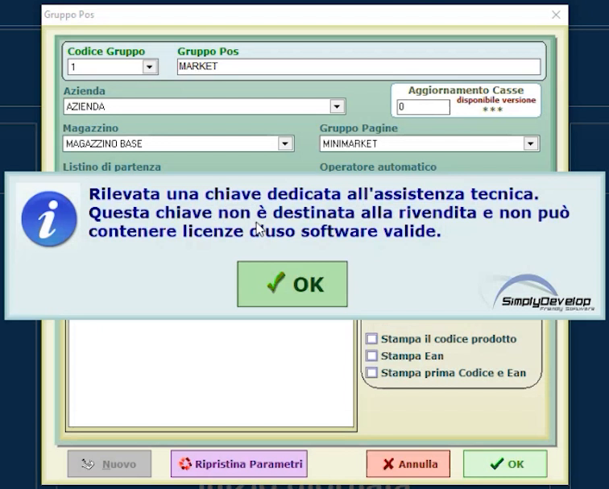

# Licenza e attivazione demo

**TARGET:** tecnico installatore · **DURATA STIMATA:** 10 minuti

## Obiettivo

Sapere come ottenere la licenza necessaria per avviare Hyperetail e come
richiedere una **versione demo a tempo** direttamente da HyperSide.

## Come si ottiene la licenza

Per avviare Hyperetail dopo il download serve una licenza. Sono possibili
queste strade:

| Modalità | Descrizione |
|---|---|
| **Licenza abbinata all'impianto** | Gestita da HyperSide, scheda **Licenza** (abbinamento tramite app HyperLand e QR code) |
| **Chiavetta arancione** | Chiave di **assistenza**, usata dal tecnico per fare assistenza e per aprire il software dopo il download |
| **Demo a tempo** | Richiesta di attivazione dimostrativa inviata da HyperSide |

## Richiesta di attivazione demo a tempo

1. In HyperSide premi l'**icona del menu** (tre linee) in alto a sinistra.

    

2. Scegli **Richiesta di attivazione dimostrativi a tempo**.
3. Compila il modulo con i **dati dell'azienda**: rivenditore autorizzato,
   denominazione dell'attività o ragione sociale, indirizzo, CAP, città,
   provincia ed eventuali note.

    

4. Premi **Invia richiesta**.
5. **Attendi l'autorizzazione**: la richiesta viene valutata dalla divisione
   sviluppo. Il modulo precisa che l'accettazione è a piena discrezione
   dell'azienda e indica anche l'indirizzo email di assistenza per richiedere
   l'attivazione.
6. Quando la richiesta è autorizzata puoi avviare Hyperetail con la licenza
   demo.

### Altre voci del menu di HyperSide

Lo stesso menu contiene anche:

- raccolta dati per attivazione **Fattura Elettronica**;
- raccolta dati per nuovo **WOGO STORE**;
- **Imposta password**;
- **Avvia assistenza remota**.

## Avviso con chiave di assistenza

Con la chiave di assistenza inserita può comparire, durante l'uso del
programma, questo messaggio:

> *Rilevata una chiave dedicata all'assistenza tecnica. Questa chiave non è
> destinata alla rivendita e non può contenere licenze d'uso software valide.*

Premi **OK** per proseguire. Le schermate di Hyperetail avviato con la chiave
di assistenza riportano in basso la dicitura **chiave tecnica non destinata
alla rivendita - NOT FOR SALE**.

!!! warning "Chiave di assistenza e impianto del cliente"
    La chiavetta arancione serve per l'assistenza e per le prove: non è una
    licenza d'uso valida per l'impianto del cliente.

## Verifica

- Hyperetail si avvia e mostra la schermata di richiesta del codice operatore.
- In HyperSide, scheda **Licenza**, lo stato del software è coerente con la
  modalità scelta.
