# Operatori, Disegnatore e pagine POS

**TARGET:** tecnico installatore · **DURATA STIMATA:** 25 minuti

## Obiettivo

Accedere a Hyperetail, entrare nella **modalità disegno** per personalizzare
le pagine, associare a ogni operatore la propria pagina di lavoro e importare
pagine di vendita già pronte.

## Prerequisiti

- Hyperetail installato e licenza attiva (anche demo).
- Per la modifica delle pagine: accesso come **amministratore**.

## Il login operatore

All'avvio Hyperetail chiede il **codice operatore** (qui sulla postazione
`CASSA01`). Ogni schermata, di vendita o di configurazione, è legata a un
operatore con la propria password.

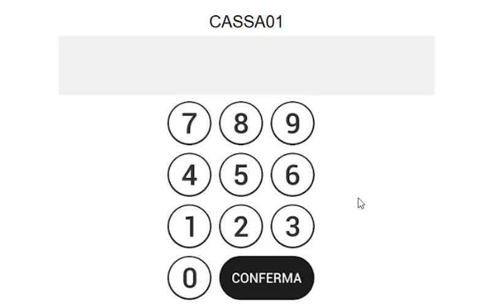

I codici operatore predefiniti di una nuova installazione sono:

| Codice | Operatore | Pagina di ingresso |
|---|---|---|
| **12345** | Operatore base di vendita | Pagina di vendita |
| **99999** | Amministratore (funzioni avanzate) | Pagina di amministrazione |

Per tornare alla schermata del codice operatore dalla pagina di vendita o di
amministrazione usa il tasto funzione **Chiave** (logout dell'operatore).

!!! tip "Password dell'amministratore"
    Entrando con il codice dell'amministratore compare la **pagina di
    amministrazione** (la pagina azzurra di configurazione), da cui si
    raggiungono Configurazioni generali, statistiche e documenti.

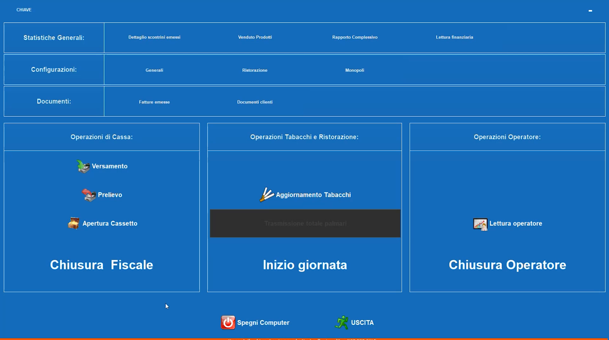

## Il Disegnatore: personalizzare ogni pagina

Ogni pagina, di configurazione, di vendita o gestionale, è completamente
personalizzabile dalla **modalità disegno**.

1. Fai **doppio clic con il tasto destro** del mouse sulla pagina (in
   alternativa usa **CTRL+SHIFT+D**).
2. Rispondi **Sì** alla domanda *Sicuri di voler entrare nella modalità
   disegno?*

    

3. Fai clic con il **tasto destro su un tasto** per aprire il menu
   contestuale del tasto:

    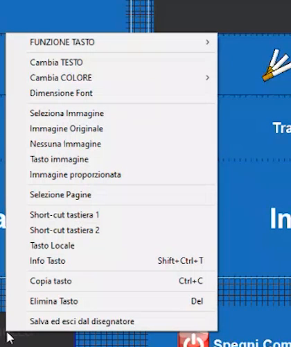

    | Voce | Funzione |
    |---|---|
    | **Cambia TESTO** / **Cambia COLORE** / **Dimensione Font** | Aspetto del tasto |
    | **Seleziona Immagine**, **Immagine Originale**, **Nessuna Immagine**, **Tasto immagine**, **Immagine proporzionata** | Immagine sul tasto |
    | **Selezione Pagine** | Collega il tasto a una pagina |
    | **Short-cut tastiera 1 / 2** | Scorciatoie da tastiera |
    | **Tasto Locale** | Tasto valido solo per la postazione |
    | **Info Tasto** (Shift+Ctrl+T) | Informazioni sul tasto |
    | **Copia tasto** (Ctrl+C) / **Elimina Tasto** (Del) | Duplica o rimuove |
    | **Salva ed esci dal disegnatore** | Chiude il Disegnatore salvando le modifiche |

4. Per **assegnare una funzione** al tasto apri **FUNZIONE TASTO**: le
   funzioni sono raggruppate per categoria (Gestione Pagine, Operatori,
   Tastierino Numerico, Reparti, Articoli/PLU, Listini, Sconto/Maggiorazione,
   Forme di Pagamento, Operazioni Cassetto, Gestione clienti, Funzioni su
   Scontrino, Documenti, Operazioni su Magazzino, Ristorazione, Prepagato,
   Operazioni su telematico, Gestione Celiachia, Gestione Eliminacode,
   Chiusure e Varie, Statistiche e stampe).

    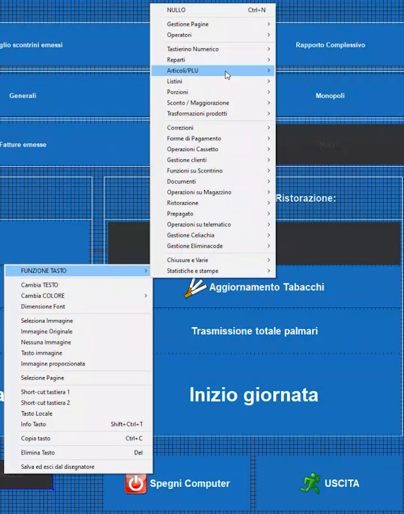

5. Per **aggiungere tasti o aree** fai clic con il tasto destro in un punto
   della pagina senza oggetti: compare un menu che permette di creare nuovi
   elementi nella posizione del puntatore.
6. Al termine scegli **Salva ed esci dal disegnatore**.

## Associare a ogni operatore la sua pagina

Gli operatori e le rispettive pagine d'ingresso si definiscono in
**Configurazioni generali → Operatori**.

1. Dalla pagina di amministrazione apri **Configurazioni → Generali**: si apre
   il menu *Configurazioni generali* (pagina 1 di 2).

    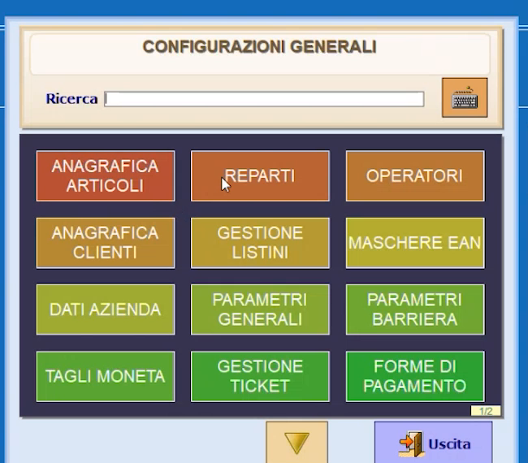

2. Premi **OPERATORI**.
3. Seleziona l'operatore: nel campo **Ingresso Pagina** scegli la pagina che
   l'operatore vedrà dopo il login.

    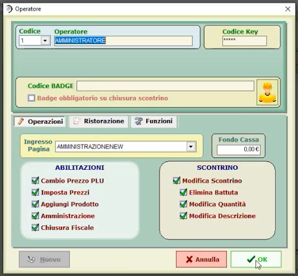

    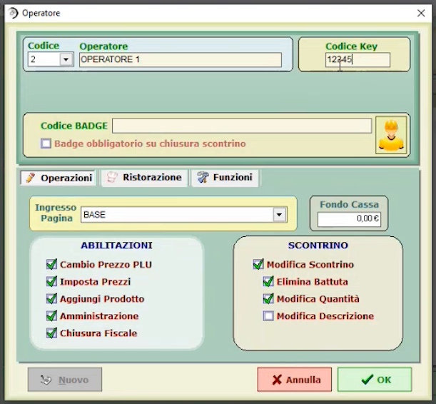

4. Nella stessa scheda imposta le **limitazioni** dell'operatore:

    | Gruppo | Opzioni |
    |---|---|
    | **Abilitazioni** | Cambio Prezzo PLU, Imposta Prezzi, Aggiungi Prodotto, Amministrazione, Chiusura Fiscale |
    | **Scontrino** | Modifica Scontrino, Elimina Battuta, Modifica Quantità, Modifica Descrizione |

    Nell'esempio l'**Operatore 1** ha tutte le opzioni attive tranne
    *Modifica Descrizione*.

5. Premi **OK**.

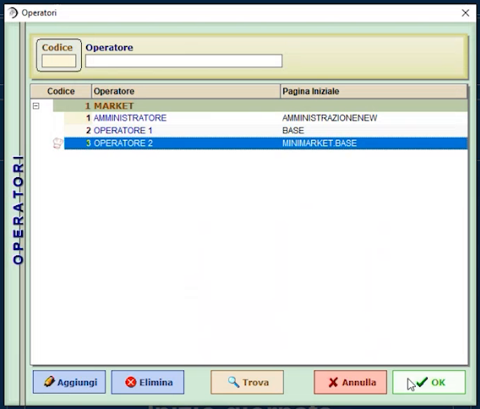

Nell'elenco, per ogni operatore compare la pagina iniziale associata
(*AMMINISTRAZIONENEW*, *BASE*, *MINIMARKET.BASE*). Dalle schede
**Ristorazione** e **Funzioni** si impostano ulteriori limitazioni.

## Pagine POS: importare pagine già pronte

Le pagine di vendita si gestiscono in **Configurazioni generali → PAGINE POS**
(pagina 2 di 2 del menu). Da qui puoi **personalizzare, creare, modificare,
esportare e importare** pagine, anche da database o da pagine create su altri
impianti.

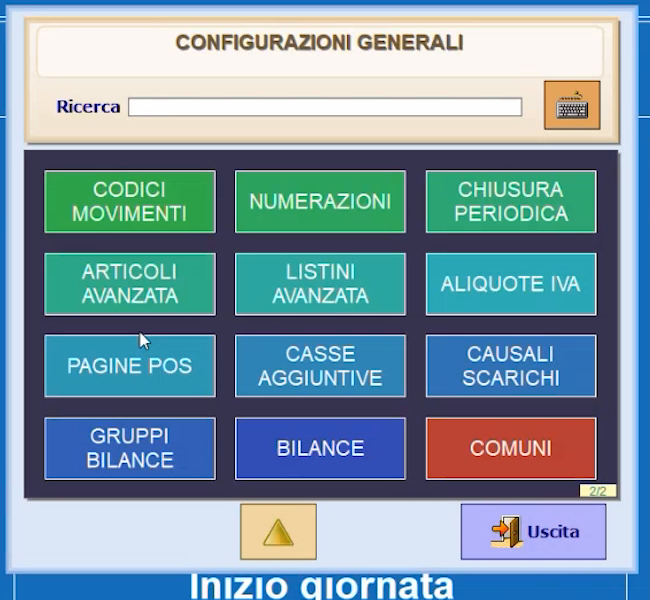

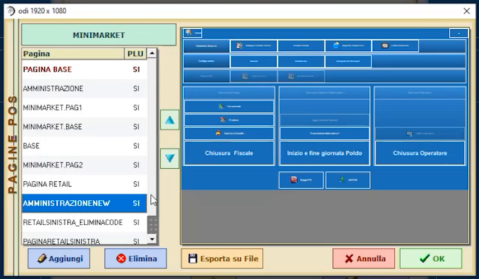

Per importare una pagina da file:

1. In **Pagine POS** premi **Aggiungi**: si apre una pagina vuota.
2. Dal pannello **IMPORT** scegli **File** (le altre voci sono **Pagina** e
   **Modello**).

    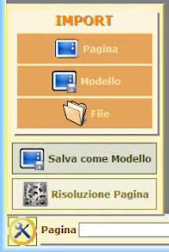

3. Seleziona il file della pagina creata in precedenza: la pagina viene
   caricata nel Disegnatore e può essere ancora modificata.

    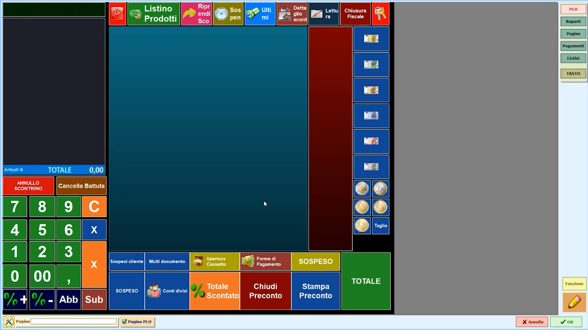

4. Assegna il **nome** alla pagina e premi **OK** per salvarla nel database.

    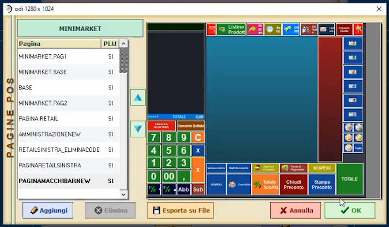

5. Torna in **Operatori** e, nel campo **Ingresso Pagina**, associa la nuova
   pagina all'operatore desiderato.

    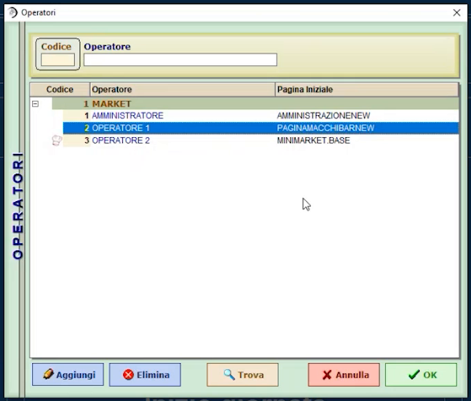

!!! note "Pagine e risoluzione"
    La pagina di vendita può avere layout diversi (anche verticale): la
    finestra *Pagine POS* indica la risoluzione della pagina selezionata.
    Dal pannello IMPORT sono disponibili anche **Salva come Modello** e
    **Risoluzione Pagina**.

## Verifica

- Esci dalla pagina con il tasto **Chiave** ed entra con il codice
  **12345**: compare la pagina di vendita che hai associato all'operatore.
- Entra con **99999**: compare la pagina di amministrazione.

## Errori comuni

| Sintomo | Causa e soluzione |
|---|---|
| L'operatore non vede la nuova pagina | Verifica in **Operatori** il campo **Ingresso Pagina**, poi esci con il tasto **Chiave** e rientra con il codice operatore |
| Non riesci a entrare nelle configurazioni | Hai usato il codice operatore base: entra con il codice dell'**amministratore** (99999) |
