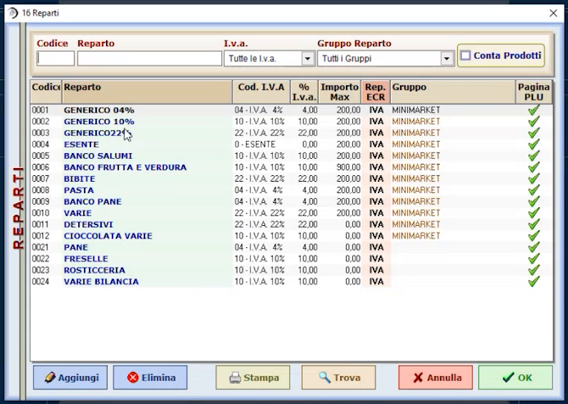
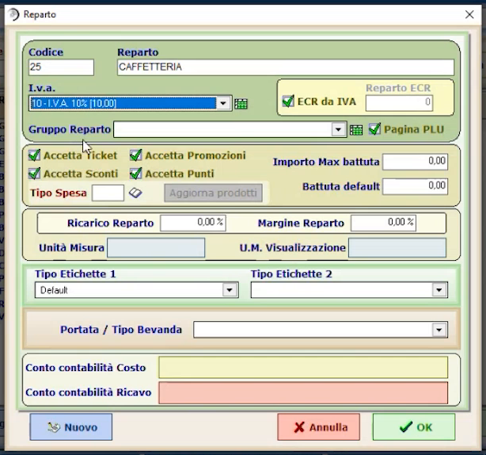
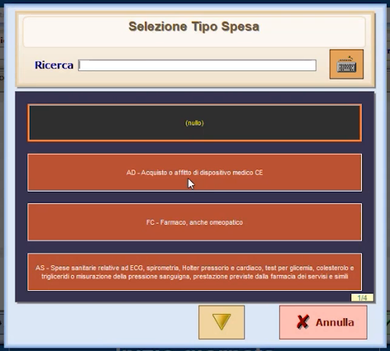
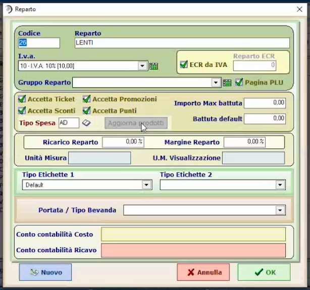

# Reparti e aliquote IVA

**TARGET:** tecnico installatore · **DURATA STIMATA:** 15 minuti

## Obiettivo

Creare i **reparti di vendita** associando a ciascuno l'aliquota IVA e
impostare le opzioni che ne determinano il comportamento in vendita (sconti,
promozioni, tipo spesa sanitaria).

## Prerequisiti

- Accesso come amministratore (codice **99999**).
- Aver letto [Operatori, Disegnatore e pagine POS](05-operatori-disegnatore-pagine.md).

## Passaggi

1. Dalla pagina di amministrazione apri **Configurazioni → Generali** e premi
   **REPARTI**.
2. Controlla l'elenco: di default il programma propone i reparti generici con
   le diverse aliquote IVA (**GENERICO 04%**, **GENERICO 10%**,
   **GENERICO 22%**).

    

3. Premi **Aggiungi**: il programma propone il **codice del reparto**.
4. Scrivi il **nome** del reparto (esempio: `CAFFETTERIA`).
5. Nel campo **I.v.a.** scegli l'aliquota di riferimento (esempio:
   `10 - I.V.A. 10% [10,00]`).
6. Verifica le opzioni di comportamento in vendita (vedi sotto).
7. Premi **OK** per salvare.

## Le opzioni del reparto

| Opzione | Significato |
|---|---|
| **Accetta Sconti**, **Accetta Promozioni** (e **Accetta Ticket**) | Stabiliscono se gli articoli del reparto partecipano a sconti, promozioni e ticket. Sono **attive di default** |
| **Gruppo Reparto** | Associa il reparto a un gruppo di reparti, le cosiddette **famiglie** |
| **Tipo Spesa** | Identifica i reparti per la gestione degli **scontrini parlanti** (vedi sotto) |

La scheda contiene anche altri campi (importo massimo di battuta, ricarico e
margine di reparto, tipo etichette, portata/tipo bevanda, conti di
contabilità) che non servono nella prima configurazione: lasciali ai valori
proposti salvo esigenze particolari.

### IVA e registratore telematico

L'IVA del reparto è associata a un **puntatore di aliquota IVA** legato alla
stampante fiscale. Di default il collegamento è già predisposto per le
stampanti fiscali **Custom**. Se devi collegare un dispositivo telematico
**non Custom**, personalizza la corrispondenza nelle **Aliquote IVA**
(*Configurazioni generali*, pagina 2 di 2).

## Reparti da escludere da sconti e promozioni

!!! warning "Tabacchi e altri reparti esclusi"
    Le opzioni **Accetta Sconti** e **Accetta Promozioni** sono attive di
    default, ma esistono reparti che devono essere esclusi dalla gestione di
    sconti e ticket. Esempio: per **tabacchi** e monopoli le opzioni devono
    essere **disattivate**: se si applica uno sconto del 10% sul totale dello
    scontrino, lo sconto deve interessare tutti gli articoli **tranne** quelli
    dei reparti esclusi.

## Tipo spesa: spese sanitarie e scontrino parlante

Il campo **Tipo Spesa** identifica i reparti che richiedono la gestione di
scontrini parlanti, ad esempio per i **dispositivi medici**.

1. Nella scheda reparto premi il **libricino** accanto a **Tipo Spesa**.
2. Scegli la voce corretta (esempio: **AD - Acquisto o affitto di dispositivo
   medico CE**).

    

3. Salva il reparto (esempio: reparto `LENTI`).

    

In vendita, gli articoli collegati al reparto consentono la **trasmissione degli
scontrini al Sistema Tessera Sanitaria** e il diritto alla detraibilità. Con
il solo **modulo base** si gestiscono quindi ottici, parafarmacie ed
erboristerie che vendono prodotti detraibili.

## Verifica

- Il nuovo reparto compare nell'elenco con il codice e l'IVA corretti.
- Nelle schede dei reparti esclusi (es. tabacchi) *Accetta Sconti* e *Accetta
  Promozioni* sono disattivate.

## Errori comuni

| Sintomo | Causa e soluzione |
|---|---|
| Lo sconto sul totale si applica anche ai tabacchi | Il reparto ha ancora attive **Accetta Sconti** / **Accetta Promozioni**: disattivale |
| Aliquota non riconosciuta dal registratore | Per RT **non Custom** va personalizzata la tabella **Aliquote IVA** |
