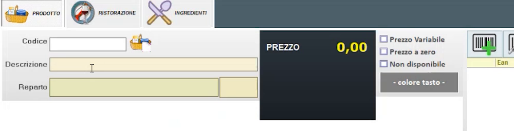
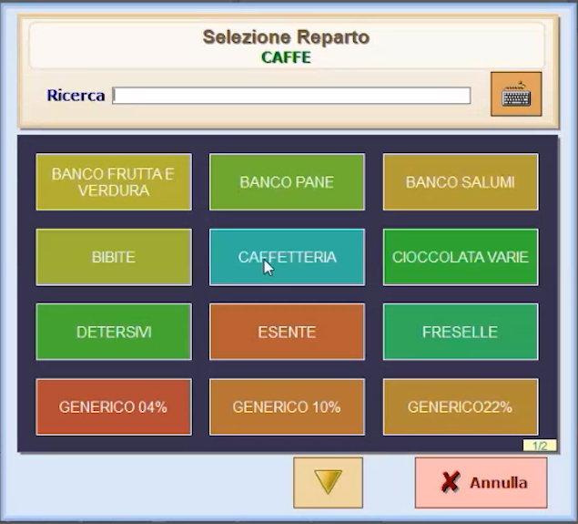
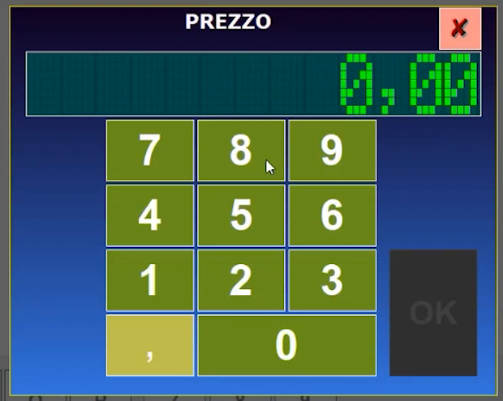
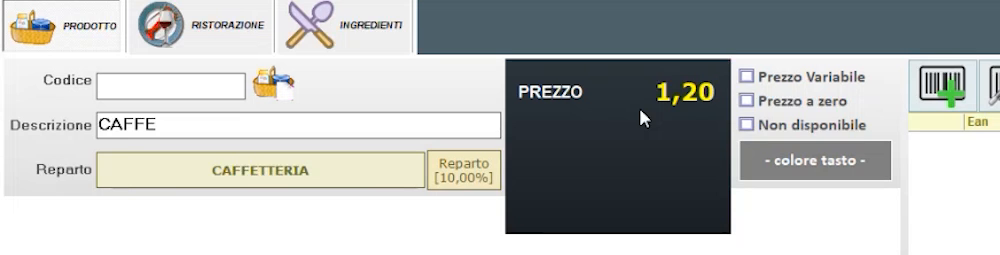
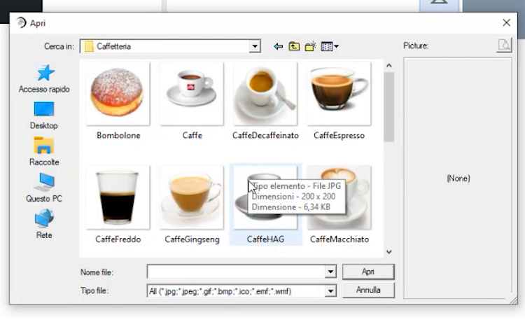
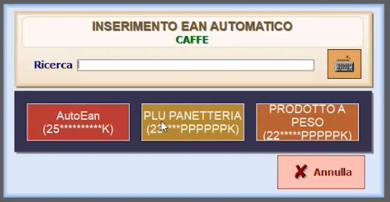
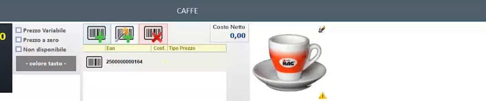
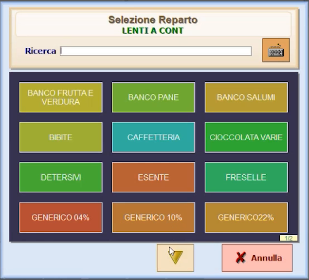
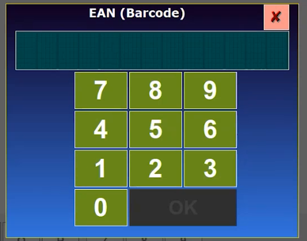

# Anagrafica articoli semplificata

**TARGET:** tecnico installatore · **DURATA STIMATA:** 20 minuti

## Obiettivo

Creare gli articoli con l'anagrafica **semplificata**: descrizione, reparto,
prezzo, immagine ed **EAN** (letto da scanner oppure generato in automatico).

## Prerequisiti

- I **reparti** sono già stati creati (vedi [Reparti e aliquote IVA](06-reparti.md)).

## Concetti da conoscere

- Il programma è **multi listino**: nella prima installazione esiste un solo
  listino (**Listino 1**), quindi compare un solo prezzo.
- Per logica del software l'**unicità dell'articolo è legata a un EAN**.
  Gli articoli che hanno un EAN (una bottiglia d'acqua, una lattina) si
  registrano con il loro EAN; per gli articoli che non ne hanno (ad esempio
  il caffè al bar) si genera un **AutoEAN**.
- Le immagini si scelgono nella **galleria immagini** della cartella
  Hyperetail, oppure da una tua cartella.

## Passaggi: articolo senza EAN (esempio: CAFFE)

1. In **Configurazioni generali** apri **ANAGRAFICA ARTICOLI**: si apre la
   scheda di inserimento nuovo articolo.

    

    Le schede in alto sono **PRODOTTO**, **RISTORAZIONE** e **INGREDIENTI**:
    le ultime due servono solo se stai configurando un impianto di
    ristorazione. Per un articolo semplice usa solo **PRODOTTO**.

2. Scrivi la **Descrizione** con la tastiera a video (esempio: `CAFFE`).
3. Premi il campo **Reparto** e scegli il reparto di appartenenza.

    

4. Premi il riquadro **PREZZO** e digita il prezzo di vendita con il
   tastierino a video.

    

    

5. Imposta, se serve, le opzioni **Prezzo Variabile**, **Prezzo a zero**,
   **Non disponibile** e il **colore tasto**.
6. **Immagine**: dal riquadro immagine dell'articolo apri la selezione file e
   scegli l'immagine dalla galleria (cartelle per categoria, ad esempio
   *Caffetteria*).

    

7. **EAN automatico**: sopra l'elenco EAN premi il pulsante di inserimento
   **EAN automatico** e scegli la maschera **AutoEan** (`25**********K`). Le
   altre maschere proposte sono **PLU PANETTERIA** e **PRODOTTO A PESO**.

    

8. Verifica che l'articolo mostri immagine ed EAN generato, poi **registra**.

    

## Passaggi: articolo con EAN (esempio: LENTI A CONTATTO)

1. Apri una nuova scheda articolo e scrivi la **Descrizione** (`LENTI A CONTATTO`).
2. Seleziona il **Reparto** `LENTI`.

    

3. Imposta il **prezzo** con il tastierino.
4. Per l'**EAN** premi **Aggiungi EAN** (primo pulsante sopra l'elenco EAN) e
   **leggi il codice con lo scanner** (oppure digitalo).

    

5. L'**immagine** non è obbligatoria: puoi non inserirla.
6. **Registra** l'articolo.

## Verifica

- Aprendo **ANAGRAFICA ARTICOLI** trovi gli articoli appena creati.
- Nella schermata di vendita l'articolo compare nella pagina del suo reparto
  (vedi [Schermata di vendita](13-schermata-di-vendita.md)).

## Attenzioni

!!! note "Anagrafica semplificata e avanzata"
    La scheda semplificata raccoglie le informazioni di base. Le informazioni
    aggiuntive (brand, varianti, categorie, costi, composizione) si gestiscono
    nella scheda **Articoli avanzata**: vedi
    [Articoli avanzati](08-articoli-avanzati.md).

!!! tip "Prezzi variabili"
    Per un articolo con prezzo a zero o prezzo variabile usa le opzioni
    **Prezzo Variabile** e **Prezzo a zero** della scheda.
