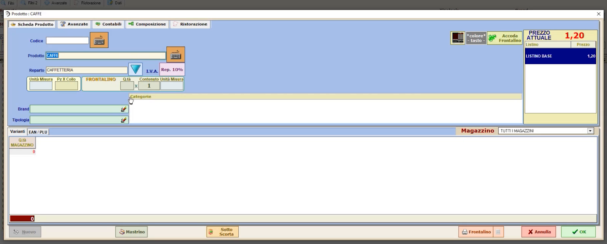
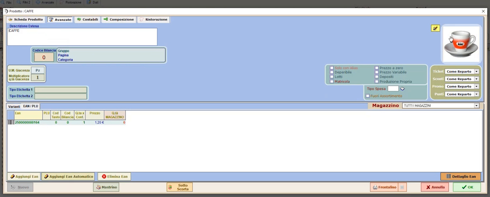
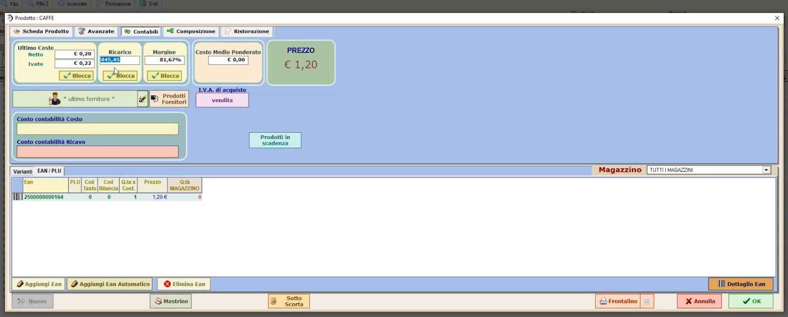
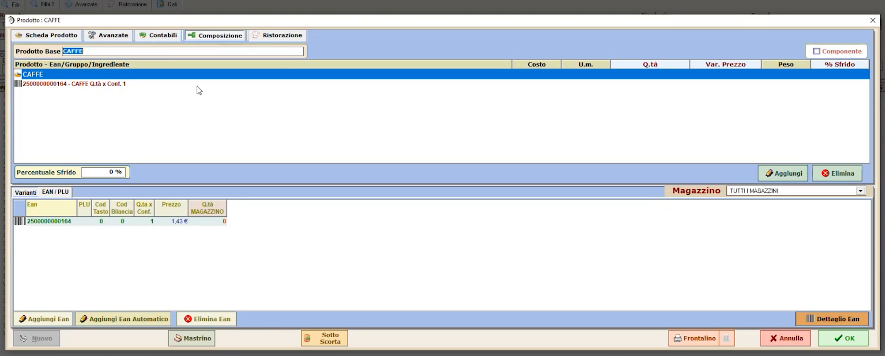

# Articoli avanzati

**TARGET:** tecnico installatore · **DURATA STIMATA:** 20 minuti

## Obiettivo

Usare la scheda **Articoli avanzata** per completare gli articoli con le
informazioni che servono a seconda dell'attività: etichette, brand, varianti,
categorie, EAN alternativi, costi e margini, composizione.

## Prerequisiti

- Articoli creati con la scheda semplificata (vedi
  [Anagrafica articoli semplificata](07-anagrafica-articoli.md)).

## Come aprire la scheda

In **Configurazioni generali, pagina 2 di 2**, premi **ARTICOLI AVANZATA**:
trovi tutti gli articoli, compresi quelli creati nella scheda semplificata.
Seleziona un articolo (esempio: `CAFFE`).

La scheda ha cinque aree: **Scheda Prodotto**, **Avanzato**, **Contabili**,
**Composizione** e **Ristorazione**.

## Scheda Avanzato

Contiene le informazioni aggiuntive da popolare quando l'attività le richiede:

- **gestione a pezzi o a chilogrammi** (unità di misura);
- **frontalini ed etichette**: il programma stampa anche frontalini ed
  etichette, quindi qui si inseriscono le informazioni necessarie a produrne
  una corretta (ad esempio per un prodotto da scaffale);
- **brand**, per esempio per gestire i marchi dei capi nel settore **fashion**;
- **varianti articolo** (taglie e colori): servono soprattutto ai fini
  statistici, così come la **tipologia**;
- **categorie**: una volta popolate permettono il collegamento con siti di
  **e-commerce** (la categoria è l'informazione chiave per l'aggancio);
- **EAN alternativi** legati allo stesso articolo;
- indicazione che l'articolo verrà **inviato automaticamente alla bilancia**;
- **immagine** caricata nella scheda semplificata.

## Scheda Contabili

La parte contabile si popola **in automatico** quando carichi bolle e fatture
dell'articolo, oppure puoi inserire i dati **manualmente**.

Esempio: un caffè costa 20 centesimi tra costo del prodotto, energia
elettrica e gestione. Il software genera automaticamente, rispetto al
prezzo di vendita, **ricarico** e **margine**.

Puoi anche procedere al contrario: partendo dal ricarico desiderato
(esempio: **550%**) il **prezzo di vendita si modifica automaticamente**
(nell'esempio da 1,20 € a 1,43 €).

Con la funzione **Blocca** puoi **bloccare la marginalità** su un articolo:
a ogni acquisto il programma può adeguare automaticamente il prezzo di
vendita, oppure proporti una variazione di prezzo che sei tu ad accettare.

## Scheda Composizione

Permette di costruire la **distinta base** dell'articolo. Il termine è
riduttivo: puoi comporre anche articoli "cesto". Esempio: un **cesto
natalizio** composto da una bottiglia di spumante, un panettone e un salame.
Crei l'articolo `CESTO NATALIZIO` e associ gli articoli che lo compongono:
questo serve a gestire correttamente le **quantità di vendita** e le
**quantità di magazzino**.

## Verifica

- L'articolo mostra nella scheda **Contabili** costo, ricarico e margine
  coerenti con il prezzo di vendita.
- Per un articolo composto, la scheda **Composizione** elenca tutti i
  componenti.

## Attenzioni

!!! note "Informazioni da compilare solo se servono"
    Nella maggior parte dei casi non è necessario compilare tutte le schede:
    popola le informazioni avanzate solo se l'attività del cliente le
    richiede (ad esempio etichette, e-commerce, magazzino, fashion).
