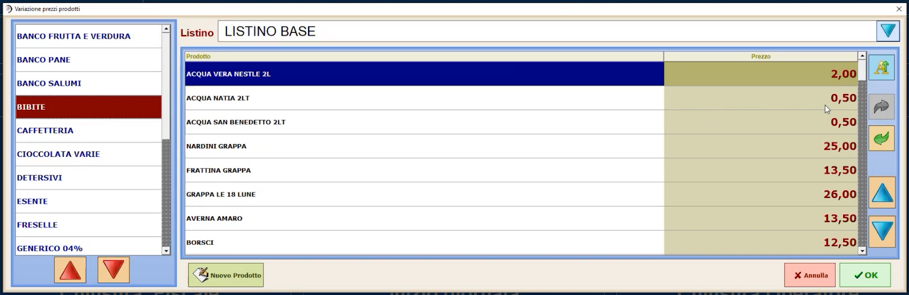
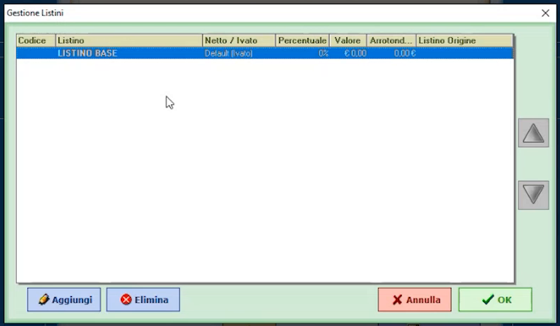
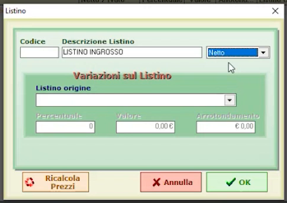
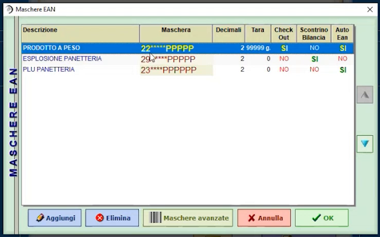
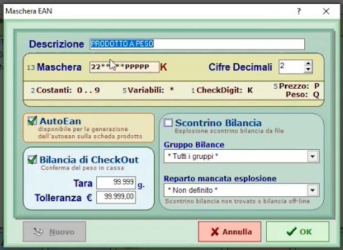

# Listini e maschere EAN

**TARGET:** tecnico installatore · **DURATA STIMATA:** 20 minuti

## Obiettivo

Gestire i **listini** (modifica rapida dei prezzi e creazione di listini
aggiuntivi) e configurare le **maschere EAN** per il riconoscimento dei
prodotti a peso e degli scontrini di bilancia.

## Prerequisiti

- Reparti e articoli già creati.

## Gestione listini: modificare i prezzi velocemente

In **Configurazioni generali** premi **GESTIONE LISTINI**. Selezionando un
listino e un reparto vedi tutti gli articoli con il relativo prezzo.

Da questa finestra puoi:

- **modificare direttamente il prezzo** di vendita degli articoli dei reparti
  creati, per variazioni di prezzo molto veloci;
- **ordinare gli articoli** nella schermata di vendita con le **frecce**
  laterali (ad esempio per mettere un articolo come primo della pagina).

## Listini avanzati: creare un secondo listino

Il programma è multi listino. Per creare un listino aggiuntivo apri
**LISTINI AVANZATA** (*Configurazioni generali*, pagina 2 di 2).

1. Premi **Aggiungi**.
2. Scrivi la **Descrizione Listino** (esempio: `LISTINO INGROSSO`).
3. Scegli se il listino è **Netto** (senza IVA) o **Ivato**. Esempio: un
   listino ingrosso si definisce **netto** perché viene gestito
   principalmente con documenti come fattura elettronica o fattura
   accompagnatoria.
4. Se vuoi creare il listino **partendo da un altro listino**, nella sezione
   **Variazioni sul Listino** indica **Listino origine** e la variazione:
   **Percentuale**, **Valore** o **Arrotondamento** (esempio: prezzo
   maggiorato del 20% rispetto a un listino esistente). Con **Ricalcola
   Prezzi** ricalcoli i prezzi.
5. Premi **OK**. Il nuovo listino si aggancia a **tutta l'anagrafica
   articoli** esistente.

    

6. Attendi la fine del messaggio **AGGIORNAMENTO IN CORSO**: l'allineamento
   può richiedere tempo in funzione del numero di articoli (nel database
   dimostrativo erano circa 30 mila).

Un listino senza listino origine è un **listino autonomo**. Una volta creato,
nelle schede articolo compaiono **due prezzi**, uno per listino.

## Maschere EAN

Le **maschere EAN** definiscono la struttura del codice per far riconoscere
al software determinati prodotti nel momento in cui vengono letti. Di default
gestiscono i **prodotti a peso**, che si identificano con un EAN che inizia con
**22**.

In **Configurazioni generali** premi **MASCHERE EAN**.

| Colonna | Significato |
|---|---|
| **Descrizione** | Nome della maschera |
| **Maschera** | Struttura del codice (es. `22*****PPPPP`) |
| **Decimali**, **Tara** | Cifre decimali del prezzo/peso e tara |
| **Check Out** | Bilancia di check-out attiva |
| **Scontrino Bilancia** | Maschera per l'esplosione dello scontrino di bilancia |
| **Auto Ean** | Maschera disponibile per la generazione AutoEAN |

Aprendo una maschera si definiscono i dettagli:

| Campo | Significato |
|---|---|
| **Maschera** | Struttura del codice di 13 cifre: **costanti** (0..9), **variabili** (`*`), **CheckDigit** (`K`), **Prezzo** (`P`), **Peso** (`Q`) |
| **Cifre Decimali** | Decimali del valore codificato |
| **AutoEan** | Rende la maschera disponibile per la generazione automatica dell'EAN dalla scheda prodotto |
| **Bilancia di CheckOut** | Conferma del peso in cassa, con **Tara** (g) e **Tolleranza** (€) |
| **Scontrino Bilancia** | Esplosione dello scontrino di bilancia da file |
| **Gruppo Bilance** | Collega la maschera a uno o più gruppi bilancia |
| **Reparto mancata esplosione** | Reparto in cui incanalare gli articoli battuti sulla bilancia che non sono agganciati a un articolo del software (ad esempio un prezzo libero) |

### Prodotti a peso e bilance

- Puoi creare maschere per i prodotti da gestire **a peso** e da inviare a una
  o più bilance (o gruppi di bilance).
- Con le bilance **Icona** e **Unica** si può usare l'**esplosione dello
  scontrino**: in questo caso non si gestisce un EAN, ma uno **scontrino
  bilancia** da riconoscere.
- Un articolo creato nella configurazione di Hyperetail viene **creato
  automaticamente anche in bilancia**: non serve nessun passaggio aggiuntivo
  né lanciare applicazioni esterne.

## Verifica

- Il nuovo listino compare nella scheda articolo con il proprio prezzo.
- La maschera EAN dei prodotti a peso riconosce un codice che inizia con `22`.

## Errori comuni

| Sintomo | Causa e soluzione |
|---|---|
| Il nuovo listino non compare subito sugli articoli | L'allineamento è ancora in corso: attendi la fine di **AGGIORNAMENTO IN CORSO** |
| Articolo battuto in bilancia senza abbinamento a un articolo | Imposta il **Reparto mancata esplosione** nella maschera dello scontrino bilancia |
