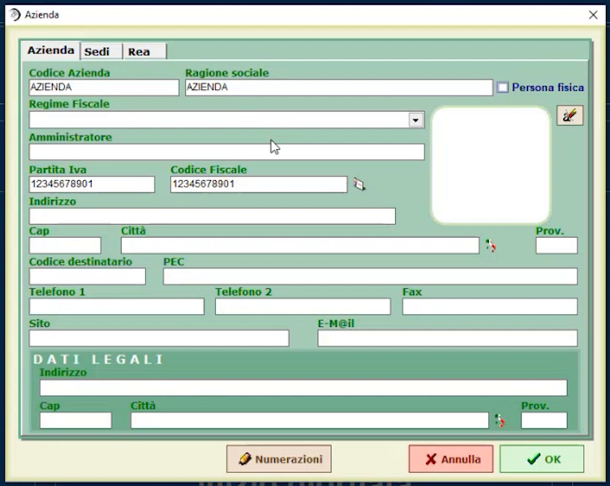
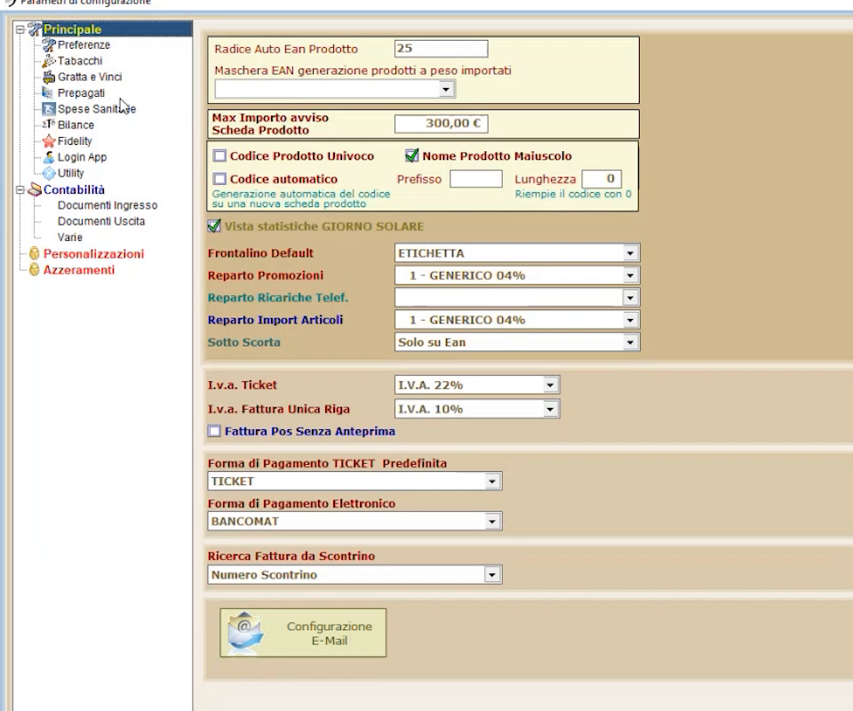
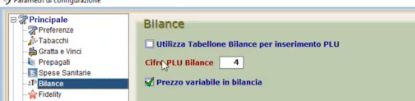
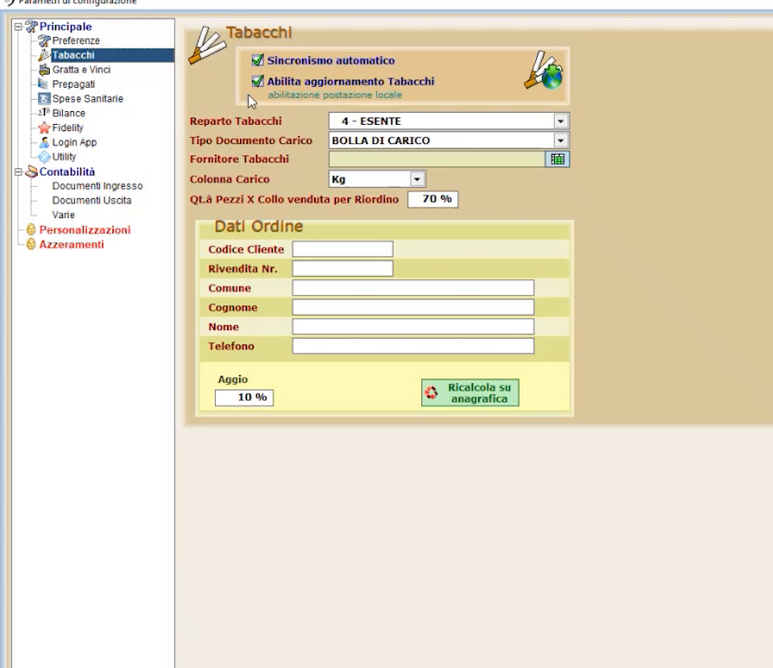
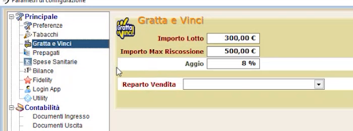

# Dati azienda e parametri generali

**TARGET:** tecnico installatore · **DURATA STIMATA:** 15 minuti

## Obiettivo

Inserire i **dati dell'azienda** che installa il software e conoscere le
sezioni dei **parametri generali**, in cui si interviene solo quando
l'attività richiede funzioni particolari.

## Dati azienda

In **Configurazioni generali** premi **DATI AZIENDA** e compila le schede
**Azienda**, **Sedi** e **Rea**: codice azienda, ragione sociale, regime
fiscale, amministratore, partita IVA e codice fiscale, indirizzo, contatti,
codice destinatario e PEC, dati legali. In un'installazione dimostrativa
puoi indicare, ad esempio, `BAR DEL SOLE`.

## Parametri generali

Apri **PARAMETRI GENERALI**. Sul lato sinistro trovi l'albero delle sezioni:

| Gruppo | Sezioni |
|---|---|
| **Principale** | Preferenze, Tabacchi, Gratta e Vinci, Prepagati, Spese Sanitarie, Bilance, Fidelity, Login App, Utility |
| **Contabilità** | Documenti Ingresso, Documenti Uscita, Varie |
| **Altro** | Personalizzazioni, Azzeramenti |

!!! tip "Quando entrare nei parametri generali"
    Nelle **prime installazioni** si entra raramente in questa sezione: vi si
    interviene solo quando esistono **esigenze particolari**. Le funzioni
    aggiuntive si scoprono man mano che servono.

### Bilance

Qui si stabilisce **con quante cifre del PLU** gestire gli articoli di
bilancia. Compaiono anche le opzioni **Utilizza Tabellone Bilance per
inserimento PLU** e **Prezzo variabile in bilancia**.

### Tabacchi

Per il **modulo Monopoli** si inseriscono qui i **dati della rivendita**, che
servono alla gestione degli ordini. La sezione contiene anche
**Sincronismo automatico**, **Abilita aggiornamento Tabacchi**, **Reparto
Tabacchi**, **Tipo Documento Carico**, **Fornitore Tabacchi** e i **Dati
Ordine**.

### Gratta e Vinci

Serve ad **associare al reparto di vendita** i gratta e vinci che man mano
vengono inseriti: il programma è **autoimparante** da questo punto di vista.
Si indicano **Importo Lotto**, **Importo Max Riscossione**, **Aggio** e il
**Reparto Vendita**.

### Contabilità: documenti in ingresso e in uscita

Le sezioni **Documenti Ingresso** e **Documenti Uscita** contengono i valori
che il programma propone nelle varie sessioni quando si emettono i documenti.
Si esaminano solo quando serve.

## Verifica

- I dati dell'azienda sono completi (ragione sociale, partita IVA, sede).
- Per gli impianti con modulo Monopoli, la sezione **Tabacchi** riporta i dati
  della rivendita.

## Attenzioni

!!! note "Parametri avanzati"
    Evita di modificare i parametri generali se non hai un'esigenza specifica:
    i valori proposti sono adatti alla maggior parte delle installazioni.
