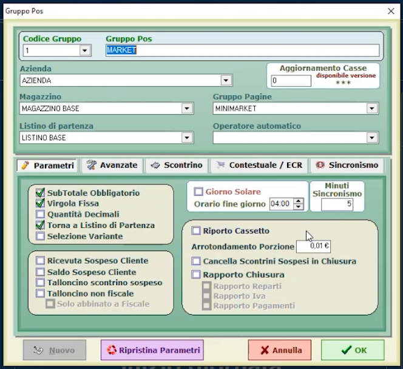
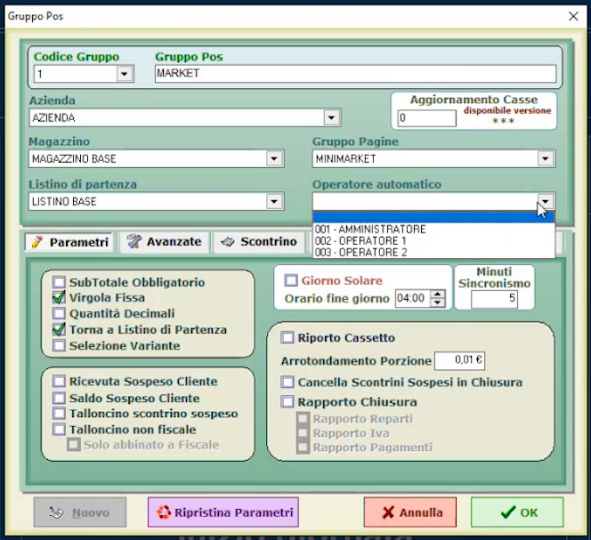
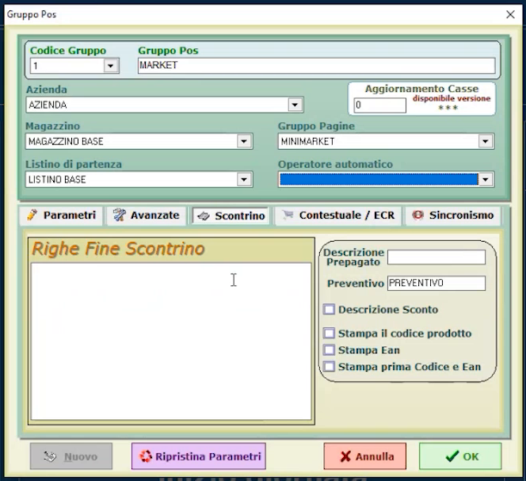
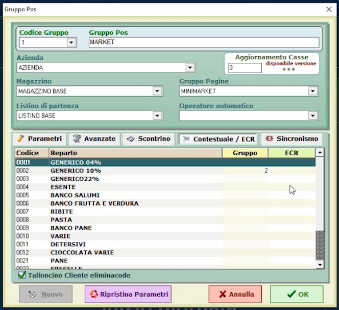
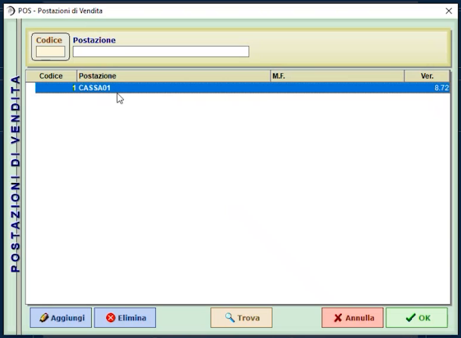
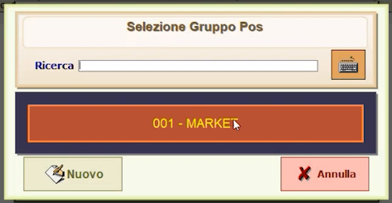

# Parametri di barriera e gruppi POS

**TARGET:** tecnico installatore · **DURATA STIMATA:** 25 minuti

## Obiettivo

Configurare il **gruppo POS** (la *barriera cassa*), che stabilisce le regole
di base dell'impianto, e gestire postazioni e casse aggiuntive.

## Prerequisiti

- Reparti, articoli e operatori configurati.
- Pagine POS e operatori associati (vedi
  [Operatori, Disegnatore e pagine POS](05-operatori-disegnatore-pagine.md)).

## Che cos'è un gruppo POS

I **parametri di barriera** determinano il "cuore" dell'azienda che si sta
meccanizzando. Si dà un nome al **gruppo POS**, che identifica la **barriera
cassa**:

- più casse (una, due, tre) possono fare riferimento allo **stesso gruppo
  POS**, e quindi lavorare in sincronismo;
- ma il software è multisettoriale: ogni cassa può anche avere **regole di
  base diverse**, personalizzando i gruppi POS separatamente.

In **Configurazioni generali** premi **PARAMETRI BARRIERA**.

## Intestazione del gruppo

| Campo | Significato |
|---|---|
| **Codice Gruppo** / **Gruppo Pos** | Numero e nome del gruppo (esempio: `1` / `MARKET`) |
| **Azienda** | Azienda di riferimento |
| **Magazzino** | Magazzino di riferimento (il software è **multi magazzino**) |
| **Gruppo Pagine** | Gruppo di pagine POS usato come schermata d'ingresso |
| **Listino di partenza** | Listino di riferimento, se esistono più listini |
| **Operatore automatico** | Operatore predefinito (vedi sotto) |

Il gruppo ha cinque schede: **Parametri**, **Avanzate**, **Scontrino**,
**Contestuale / ECR** e **Sincronismo**.

## Scheda Parametri

La scheda raccoglie le regole di base di ogni cassa, che possono essere
**uguali o diverse** da un gruppo all'altro.

| Opzione | Note |
|---|---|
| **SubTotale Obbligatorio** | Obbliga a premere SubTotale prima di prendere lo scontrino. In un **bar** può risultare fastidioso e conviene **toglierlo**; è utile invece in un **market**, dove dopo una serie di articoli battuti serve un ulteriore controllo |
| **Virgola Fissa** | Gli importi sono interpretati in **centesimi di euro** (come indicato dal suggerimento a video) |

Nella stessa scheda trovi altre opzioni: **Quantità Decimali**, **Torna a
Listino di Partenza**, **Selezione Variante**, **Ricevuta Sospeso Cliente**,
**Saldo Sospeso Cliente**, **Talloncino scontrino sospeso**, **Talloncino non
fiscale**, **Giorno Solare** con **Orario fine giorno**, **Minuti
Sincronismo**, **Riporto Cassetto**, **Arrotondamento Porzione**,
**Cancella Scontrini Sospesi in Chiusura** e **Rapporto Chiusura**. Nella
prima installazione lasciale ai valori predefiniti, salvo esigenze
dell'attività.

!!! note "Valori da adattare all'attività"
    Le regole variano in funzione dell'attività: un bar e un market hanno
    esigenze diverse sul SubTotale obbligatorio e sulla Virgola Fissa.

## Operatore automatico

Se associ un **operatore automatico** al gruppo POS, all'avvio non serve fare
il login: il programma entra **direttamente nella schermata di vendita**.
Lascia il campo vuoto se vuoi che ogni operatore acceda con il proprio codice.

## Scheda Scontrino

Personalizza la **parte in coda allo scontrino** (**Righe Fine Scontrino**) e
le opzioni di stampa: **Descrizione Prepagato**, **Preventivo**,
**Descrizione Sconto**, **Stampa il codice prodotto**, **Stampa Ean**,
**Stampa prima Codice e Ean**.

Puoi anche far stampare, **per ogni scontrino, un codice a barre** che lo
identifica: è utile soprattutto nel **fashion**, per la gestione dei resi.

## Scheda Contestuale / ECR

- **Ticketing anche con il modulo base:** puoi impostare il software perché
  emetta **comande** e **sub-comande**. Assegnando il **gruppo di riferimento**
  al reparto stabilisci su quale **stampante comande** stampare gli articoli
  associati.
- **Colonna ECR** (attivabile con il tasto destro): serve nelle attività con
  **doppia partita IVA**, ad esempio un bar-tabacchi in cui il monopolio è una
  ditta individuale e il bar è gestito da una società. Con **un unico
  scontrino** puoi **deviare** gli articoli del bar su una stampante fiscale e
  quelli legati all'attività di monopolio (sigarette, cartine, accendini) su una
  **seconda stampante fiscale** con una seconda intestazione.

## Postazioni di vendita e casse aggiuntive

Le casse si gestiscono in **Configurazioni generali, pagina 2 di 2 → CASSE
AGGIUNTIVE**. Con una sola cassa (monocassa) l'elenco riporta una sola
postazione.

Per aggiungere una seconda cassa:

1. Premi **Aggiungi**.
2. Indica il **riferimento cassa** (esempio: cassa numero 2).
3. Scegli il **gruppo POS** di riferimento.

    

4. Indica il **magazzino** di riferimento.

La nuova cassa **prende le regole del gruppo POS** impostato.

!!! tip "Tagli moneta e gestione ticket"
    Le voci **TAGLI MONETA** e **GESTIONE TICKET** di *Configurazioni generali*
    si possono saltare nella prima installazione.

## Verifica

- Entrando in vendita, la cassa usa la pagina d'ingresso, il magazzino e il
  listino impostati nel gruppo POS.
- Con l'operatore automatico impostato, il programma parte senza richiedere
  il codice operatore.

## Errori comuni

| Sintomo | Causa e soluzione |
|---|---|
| In un bar è necessario premere sempre SubTotale | Disattiva **SubTotale Obbligatorio** nel gruppo POS |
| All'avvio non compare la richiesta del codice operatore | È impostato un **Operatore automatico** nel gruppo POS: svuota il campo per riattivare il login |
