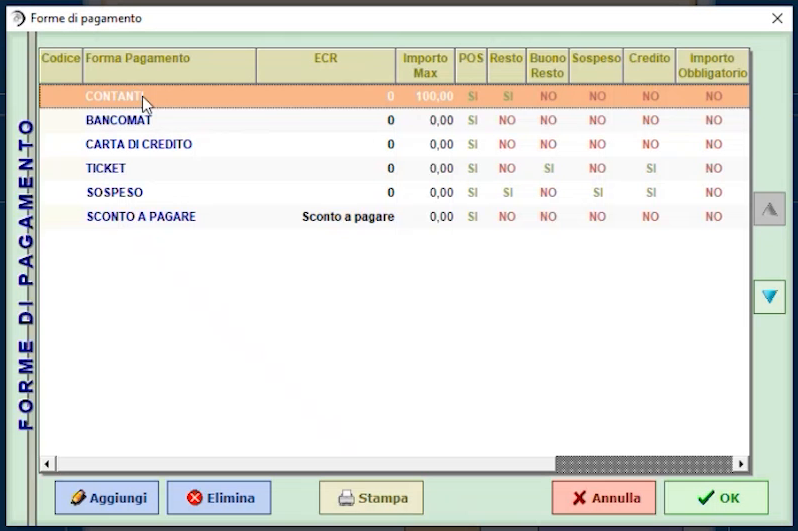
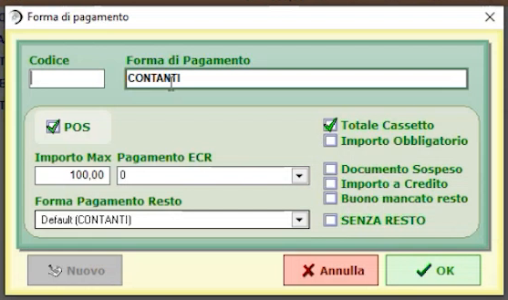
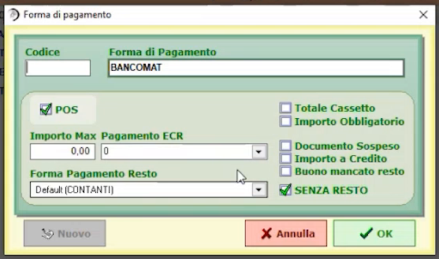
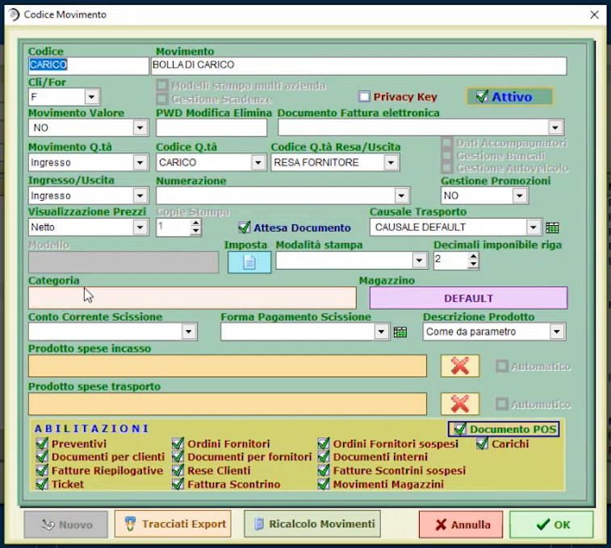
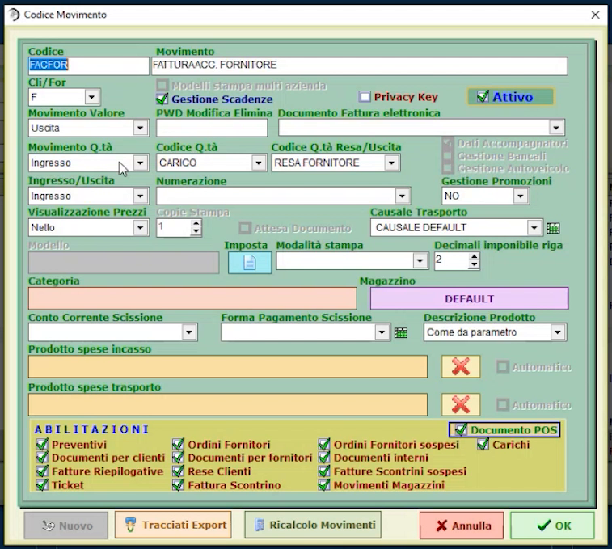
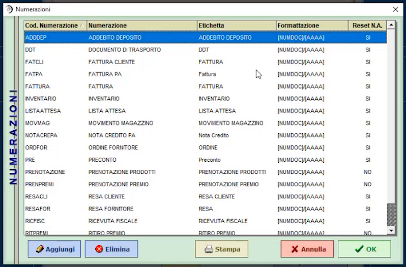
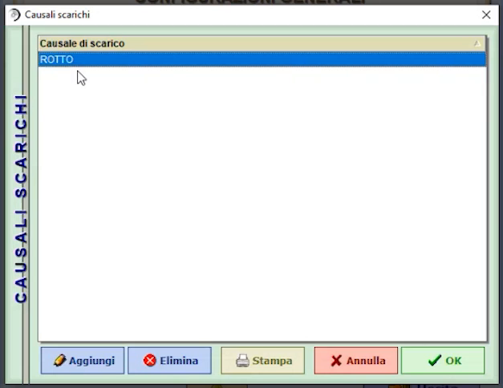

# Forme di pagamento, codici movimento e causali

**TARGET:** tecnico installatore · **DURATA STIMATA:** 20 minuti

## Obiettivo

Conoscere e adattare le tabelle che definiscono l'impatto contabile degli
incassi (**forme di pagamento**), il comportamento dei documenti
(**codici movimento**), le **numerazioni** e le **causali di scarico**.

## Prerequisiti

- Accesso come amministratore alle **Configurazioni generali**.

!!! tip "Quando intervenire"
    Le forme di pagamento sono già impostate di default per le stampanti
    fiscali Custom. Codici movimento, numerazioni e causali si modificano solo
    se c'è una necessità del cliente.

## Forme di pagamento

In **Configurazioni generali** premi **FORME DI PAGAMENTO**. Per ogni forma di
pagamento si stabilisce l'**impatto contabile** dell'incasso.

L'elenco di default contiene **CONTANTI**, **BANCOMAT**, **CARTA DI CREDITO**,
**TICKET**, **SOSPESO** e **SCONTO A PAGARE**.

| Opzione | Significato |
|---|---|
| **Totale Cassetto** | L'incasso viene **conteggiato nella parte economica del cassetto** |
| **Pagamento ECR** | Stabilisce su quale forma di pagamento deve andare la gestione **fiscale** della stampante |
| **SENZA RESTO** | La forma di pagamento non prevede il resto |

La scheda contiene anche **POS**, **Importo Obbligatorio**, **Importo Max**,
**Forma Pagamento Resto**, **Documento Sospeso**, **Importo a Credito** e
**Buono mancato resto**: lasciali ai valori predefiniti salvo esigenze
specifiche.

- **CONTANTI** conteggia nella parte del **cassetto** e va sulla forma di
  pagamento fiscale della stampante.

    

- **BANCOMAT** non conteggia la parte economica del cassetto e ha **SENZA
  RESTO** attivo, perché lo scontrino coincide quasi sempre con l'importo
  pagato.

    

## Codici movimento

In **Configurazioni generali, pagina 2 di 2** premi **CODICI MOVIMENTI**. Oltre
ai documenti fiscali esistenti in Italia (fattura accompagnatoria, fattura
scontrino, fattura cliente, bolle di carico, preventivi...) puoi creare i
tuoi codici di movimento e stabilire **l'influenza del documento
sull'operazione di magazzino**.

Esempio: la **bolla di carico** aggiorna le **quantità di magazzino** ma non
la parte contabile (*Movimento Valore: NO*), perché alla bolla seguirà la
fattura.

La **fattura** interviene invece sulla parte economica e aggiorna il
**prezzo di acquisto** del prodotto, senza toccare le quantità già caricate con
la bolla. Una **fattura accompagnatoria fornitore** interviene su
**quantità e contabilità** insieme, perché è l'unico documento che
perfeziona completamente l'operazione.

!!! note "Codici personalizzati"
    Creando nuovi codici movimento puoi soddisfare esigenze particolari.
    Esempio: un codice **impegnativa al cliente** che scarica subito il
    magazzino (il prodotto risulta impegnato) senza generare un documento
    fiscale.

## Numerazioni

**NUMERAZIONI** elenca la numerazione di tutti i documenti attivi: codice,
descrizione, etichetta e formattazione (ad esempio `[NUMDOC]/[AAAA]`), con la
colonna **Reset N.A.**.

## Causali di scarico

In **CAUSALI SCARICHI** definisci le causali per gli scarichi di magazzino
(esempio: `ROTTO`). Poiché il programma gestisce anche il magazzino, puoi
personalizzarle in base al controllo del personale: ad esempio **rotto**,
**consumato dal personale**, **smarrito**.

## Gruppi bilance e bilance

**GRUPPI BILANCE** fa riferimento alle **barriere bilancia**, non
necessariamente collegate al modulo base; **BILANCE** serve per la creazione
delle bilance stesse.

## Verifica

- Le forme di pagamento in uso hanno il **Totale Cassetto** e **Senza resto**
  coerenti con la modalità di incasso.
- I documenti usati dal cliente compaiono in **NUMERAZIONI**.

## Attenzioni

!!! warning "Chiusure periodiche"
    La funzione **CHIUSURA PERIODICA** (*Configurazioni generali*, pagina 2 di
    2) non è trattata in questa guida.
