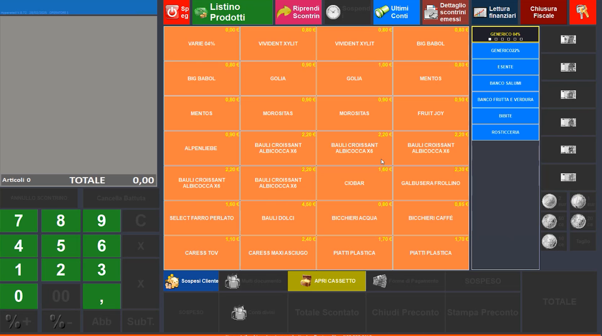
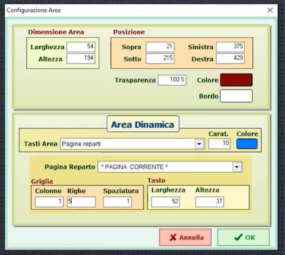
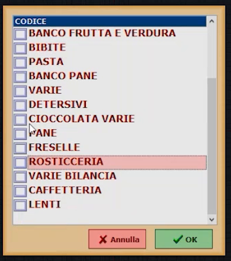
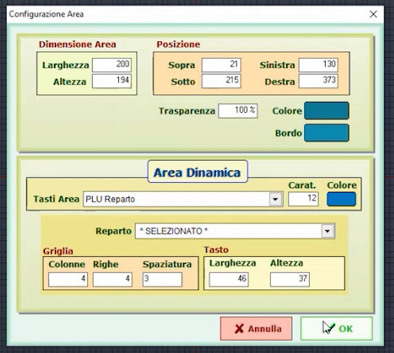
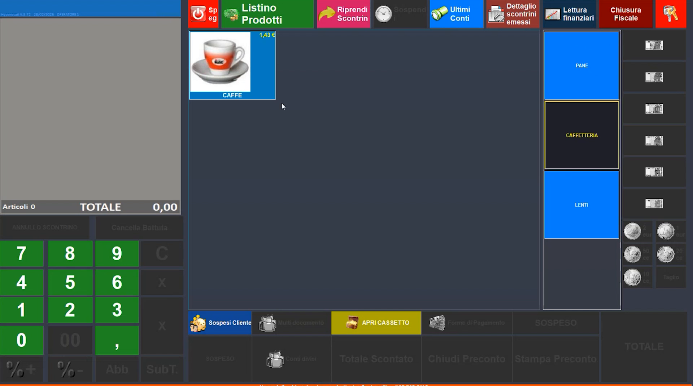
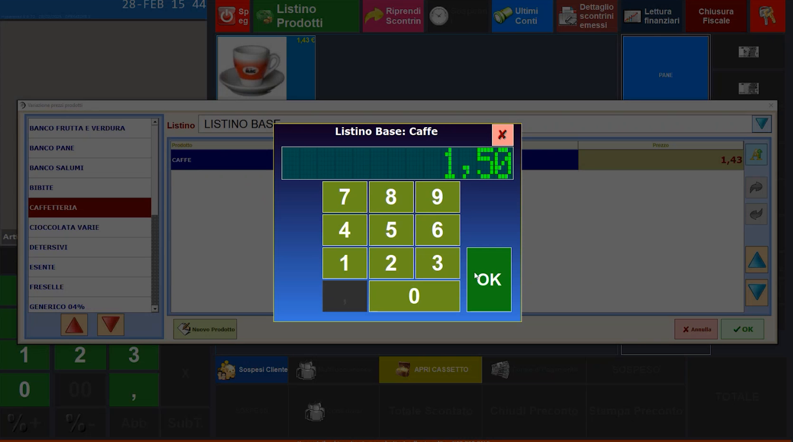
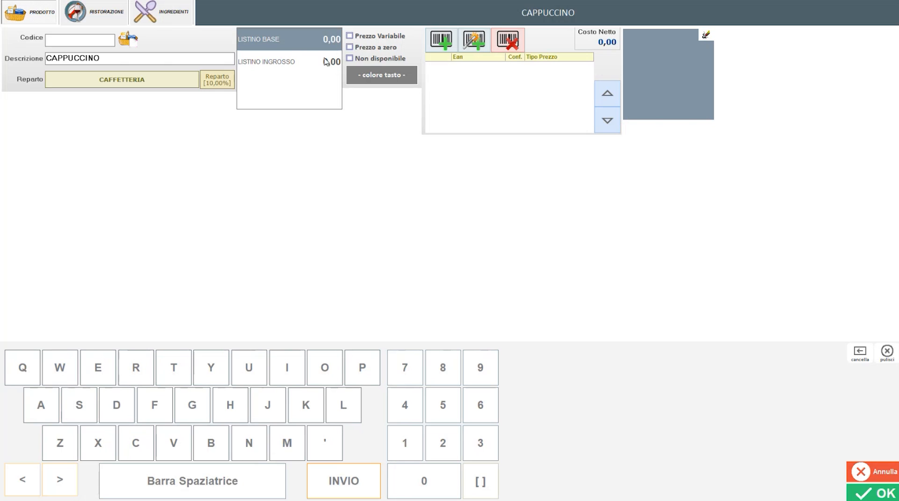
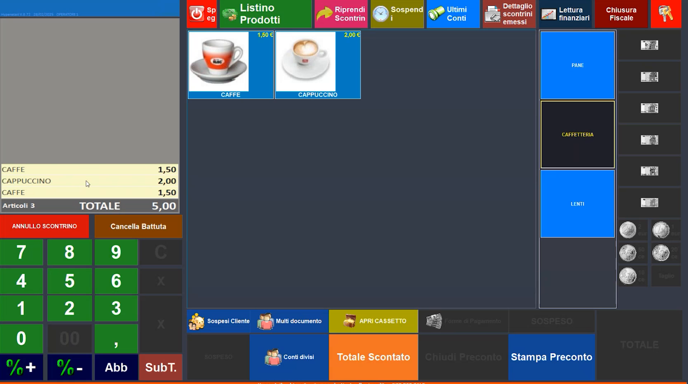
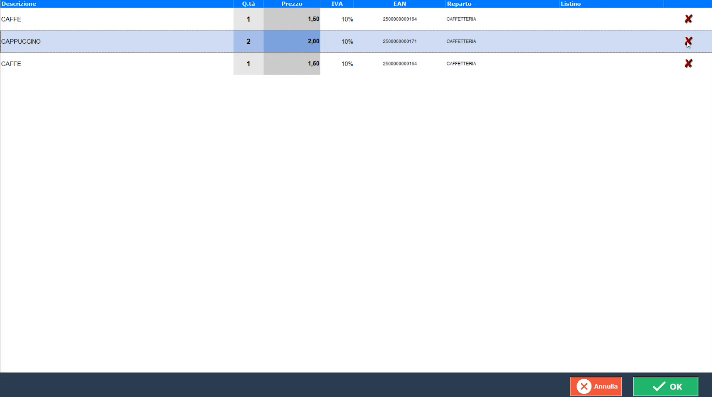

# Personalizzazione e uso della schermata di vendita

**TARGET:** tecnico installatore · **DURATA STIMATA:** 25 minuti

## Obiettivo

Personalizzare la schermata di vendita (aree dinamiche di reparti e PLU),
fornire al cliente le funzioni per gestire da sé prezzi e nuovi prodotti e
verificare il funzionamento battendo uno scontrino.

## Prerequisiti

- Reparti e articoli creati.
- Operatore associato alla pagina di vendita (vedi
  [Operatori, Disegnatore e pagine POS](05-operatori-disegnatore-pagine.md)).

## Entrare nella schermata di vendita

Dopo aver completato le configurazioni generali, esci e rientra con il codice
dell'operatore di vendita (esempio: **12345**). Vedi tutto il lavoro svolto
sulla pagina associata all'operatore.

## Personalizzare le aree dinamiche

Nella pagina di vendita le zone che mostrano reparti e articoli sono **aree
dinamiche**. Si modificano nel Disegnatore.

1. Entra nel Disegnatore (**doppio clic con il tasto destro** oppure
   **CTRL+SHIFT+D**) e conferma con **Sì**.
2. Fai clic con il tasto destro sull'**area dinamica dei reparti** e scegli
   **Impostazioni Area** per aprirne la configurazione (*Configurazione
   Area*).

    

3. Regola le impostazioni:

    | Gruppo | Campi |
    |---|---|
    | **Dimensione Area** | Larghezza, Altezza |
    | **Posizione** | Sopra, Sotto, Sinistra, Destra |
    | **Aspetto** | Trasparenza, Colore, Bordo |
    | **Area Dinamica** | **Tasti Area** (*Pagine reparti* o *PLU Reparto*), caratteri, colore, **Pagina Reparto** |
    | **Griglia** | **Colonne**, **Righe**, **Spaziatura** |
    | **Tasto** | Larghezza, Altezza |

    Nell'esempio l'area dei reparti è una griglia di **1 colonna e 5 righe**.

4. Scegli **quali reparti** mostrare in vendita: nella finestra di selezione
   togli tutti i segni di spunta e lascia solo quelli desiderati (esempio:
   `CAFFETTERIA`, `LENTI` e `PANE`).

    

5. Fai la stessa operazione per l'**area dinamica dei PLU** (**Tasti Area**
   *PLU Reparto*): imposta **colonne**, **righe**, **spaziatura** tra gli
   articoli e **colore** (ad esempio un colore personalizzato più neutro).

    

6. Premi **OK**, esci dal Disegnatore con **Salva ed esci dal disegnatore**:
   le modifiche sono immediatamente visibili.
7. Seleziona il reparto `CAFFETTERIA`: compare l'articolo creato in
   precedenza.

## Funzioni per il cliente finale

Dalla schermata di vendita puoi attivare funzioni che consentono **al cliente
di personalizzare il software** senza contattare sempre l'assistenza. Il
tasto **Listino Prodotti** (in alto nella schermata di vendita) apre la
finestra del listino, da cui il cliente può:

- **modificare i prezzi di vendita** direttamente dalla schermata di vendita;
- **riordinare gli articoli** con le frecce laterali;
- **aggiungere un nuovo prodotto** con il pulsante **Nuovo Prodotto**.

### Modificare un prezzo

Premi **Listino Prodotti**, scegli il reparto e l'articolo e digita il nuovo
prezzo con il tastierino.

### Aggiungere un nuovo prodotto

Dalla finestra del listino premi **Nuovo Prodotto**: si apre la scheda di
inserimento articolo, con i **due prezzi** (uno per ciascun listino, se ne hai
creati due). Inserisci descrizione (esempio: `CAPPUCCINO`), reparto, prezzo
(esempio: 2,00 €), EAN automatico e immagine.

!!! warning "Nuovi articoli strutturati"
    Quando inserisci articoli più strutturati devi **uscire e rientrare** con
    il tuo codice operatore per vedere le modifiche e l'articolo creato.

## Battere uno scontrino

1. Premi gli articoli sulla schermata di vendita: compaiono nello scontrino
   (qui in alto a sinistra).

    

2. Dalla schermata di vendita puoi entrare nello **scontrino a video
   virtuale**, dove puoi **modificare le quantità**, **annullare** e
   **modificare i prezzi**.

    

3. Le operazioni consentite dipendono dalle **limitazioni dell'operatore**
   (vedi [Operatori](05-operatori-disegnatore-pagine.md)). In vendita sono
   disponibili anche la gestione degli scontrini **sospesi**, **Riprendi
   Scontrino**, **Ultimi Conti** e **Dettaglio scontrini emessi**.

!!! note "Chiusura dello scontrino"
    Per emettere lo scontrino fiscale occorre collegare la **stampante
    fiscale**: vedi [File INI, registratore telematico, cassetto e POS](14-file-ini-dispositivi.md).

## Verifica

- La pagina di vendita mostra solo i reparti scelti e gli articoli con colori
  e griglia impostati.
- Un articolo battuto compare nello scontrino e si può modificare solo se
  l'operatore è abilitato.

## Errori comuni

| Sintomo | Causa e soluzione |
|---|---|
| Un articolo appena creato non compare in vendita | Per gli inserimenti più strutturati esci con il tasto **Chiave** e rientra con il codice operatore |
| L'operatore non può modificare quantità o prezzi | La funzione dipende dalle **abilitazioni dell'operatore**: controllale in **Operatori** |
