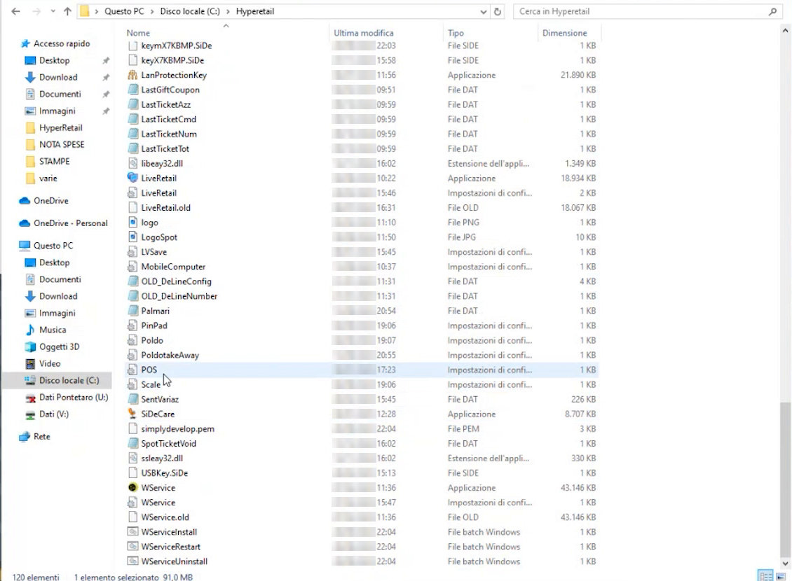
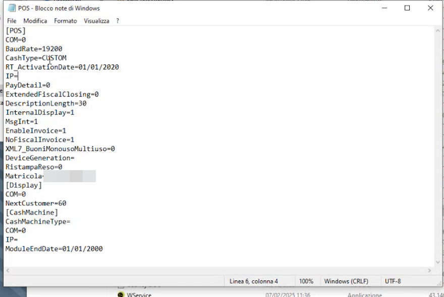
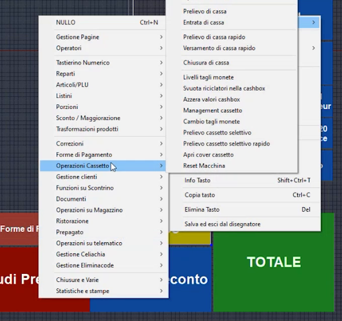
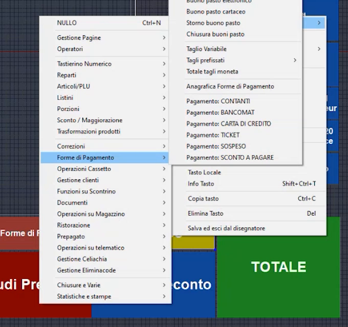
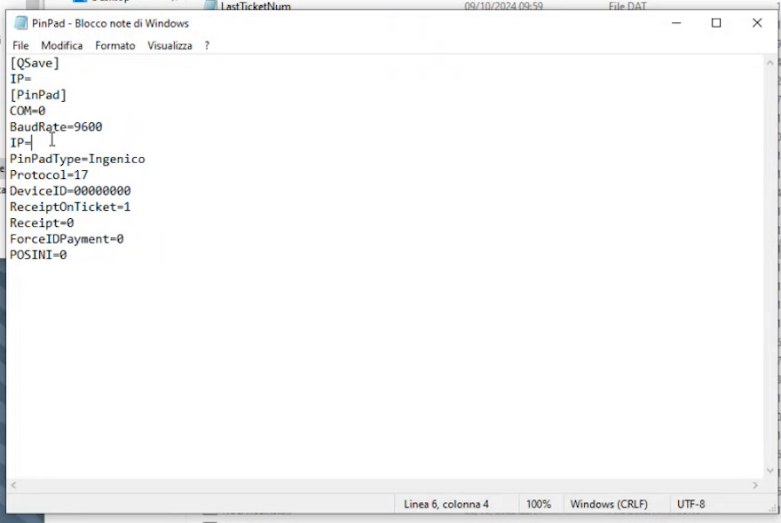
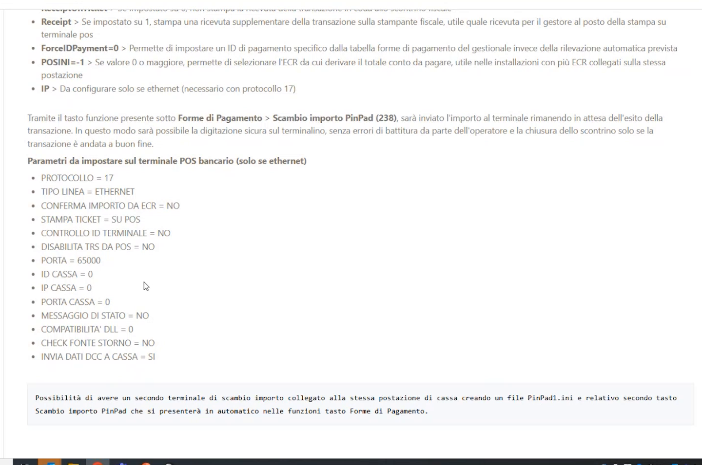
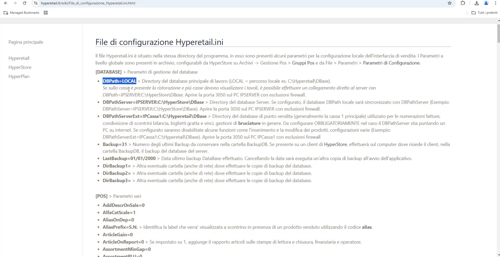
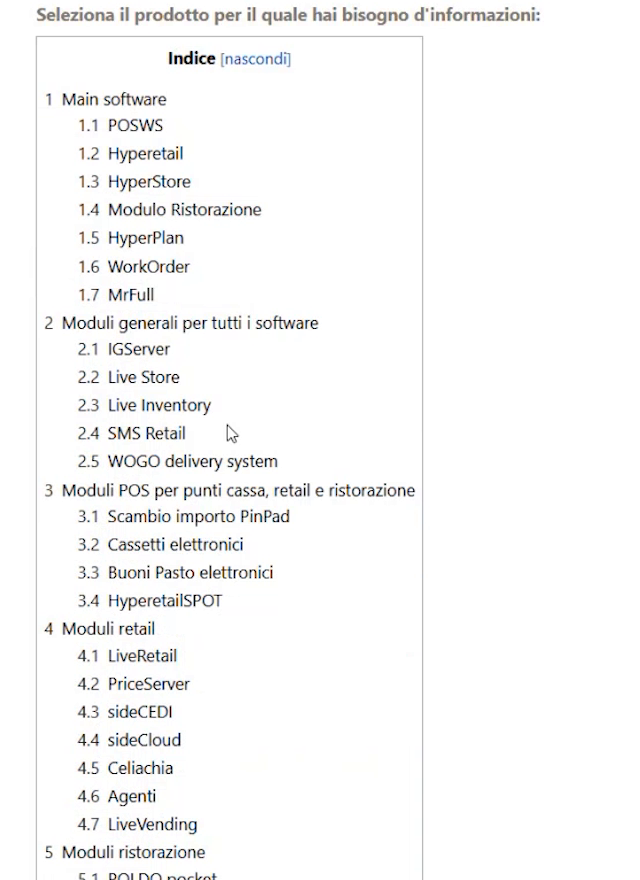
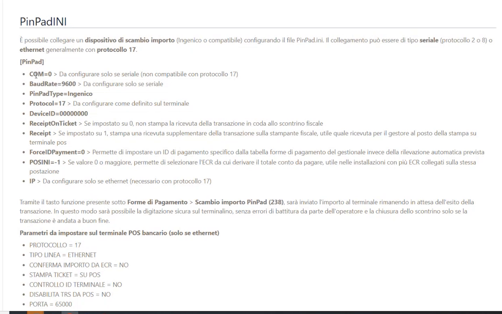

# File INI, registratore telematico, cassetto elettronico e POS

**TARGET:** tecnico installatore · **DURATA STIMATA:** 30 minuti

## Obiettivo

Collegare a Hyperetail il **registratore telematico**, il **cassetto
elettronico** e il **POS bancario** modificando i file di configurazione
**INI** nella cartella di installazione.

## Prerequisiti

- Hyperetail installato e configurato fino alla schermata di vendita.
- Registratore telematico Custom collegato via **seriale** o **LAN**
  (protocollo Custom, impostato di default).
- Per cassetto e POS: modello e indirizzo IP del dispositivo.

## I file INI

I file INI si trovano nella cartella di installazione (`C:\Hyperetail`) e si
modificano con il **Blocco note**. Prima di intervenire esci da Hyperetail (è
sufficiente anche ridurlo a icona).

| File | Funzione |
|---|---|
| `POS.ini` | Collegamento della stampante fiscale (e del cassetto elettronico) |
| `PinPad.ini` | Collegamento del POS bancario (scambio importo) |
| `Hyperetail.ini` | Configurazione generale del software (database e altre impostazioni) |

## Collegare il registratore telematico (POS.ini)

1. Esci da Hyperetail (o riducilo a icona).
2. Apri `POS.ini` con il Blocco note.

    

3. Nella sezione `[POS]` imposta il collegamento:

    | Collegamento | Cosa impostare |
    |---|---|
    | **Seriale** | `COM=` con il numero della porta COM collegata e `BaudRate=` |
    | **LAN** | `IP=` con l'indirizzo IP della stampante fiscale |

    Il protocollo è già impostato su **Custom** (`CashType=CUSTOM`).

4. **Salva** il file e avvia Hyperetail.
5. Al primo collegamento il software si connette alla stampante fiscale e
   rileva anche la **matricola** del registratore, che riporta nel file
   (`Matricola=`).

!!! tip "Cassetto e display"
    Nello stesso file sono presenti le sezioni `[Display]` e
    `[CashMachine]` per il display cliente e per il cassetto elettronico.

## Collegare il cassetto elettronico (POS.ini)

Il **modulo base** si collega da solo ai principali cassetti elettronici
presenti sul mercato. Si configura nella sezione `[CashMachine]` di `POS.ini`:

| Cassetto | Cosa scrivere |
|---|---|
| **Glory** | `CashMachineType=Glory` e `IP=` con l'indirizzo IP del cassetto |
| **CashMedic** | `CashMachineType=CashMedic`, **senza indirizzo IP**: il software riconosce la cartella del driver di CashMedic installato in Windows |

### Attivare il tasto in vendita

La connessione va poi **abilitata** nella schermata di vendita:

1. Entra nel **Disegnatore** (doppio clic con il tasto destro oppure
   **CTRL+SHIFT+D**).
2. Tasto destro sul tasto da usare → **Funzione tasto**.
3. Assegna la funzione dal menu **Forme di Pagamento** o **Operazioni
   Cassetto**: puoi attivare direttamente il pagamento (esempio:
   **Bancomat**) oppure il totale con **cassetto automatico**. Il menu
   *Operazioni Cassetto* contiene anche prelievo e versamento di cassa,
   livelli tagli moneta e apertura del cassetto.

    

4. Salva ed esci dal Disegnatore. Al clic sul tasto si accende il cassetto
   elettronico.

## Collegare il POS bancario (PinPad.ini)

Hyperetail gestisce lo **scambio importo** con il POS (protocollo **17**):
l'importo viene inviato al terminale e Hyperetail resta in attesa dell'esito
della transazione.

### 1. Creare il tasto

1. Entra nel Disegnatore, tasto destro → **Funzione tasto**.
2. Scegli **Forme di Pagamento → Scambio importo PinPad**.

    

3. Personalizza **testo**, **colore** e **forma** del tasto (ad esempio
   rinomina il tasto in *Bancomat*). Puoi creare più tasti.
4. Salva ed esci dal Disegnatore.

### 2. Configurare PinPad.ini

Apri `PinPad.ini` con il Blocco note e indica l'**indirizzo IP del terminale
POS**.

| Parametro | Significato |
|---|---|
| `COM`, `BaudRate` | Solo per collegamento **seriale** (non compatibile con protocollo 17) |
| `PinPadType=Ingenico` | Tipo di terminale |
| `Protocol=17` | Da configurare come definito sul terminale |
| `IP=` | Solo per **ethernet** (necessario con protocollo 17): indirizzo IP del terminale |
| `ReceiptOnTicket` | Se `0`, non stampa la ricevuta della transazione in coda allo scontrino fiscale |
| `Receipt` | Se `1`, stampa una ricevuta supplementare sulla stampante fiscale (utile come ricevuta per il gestore al posto della stampa su terminale POS) |
| `ForceIDPayment` | Permette di impostare un ID di pagamento specifico dalla tabella forme di pagamento del gestionale invece della rilevazione automatica |
| `POSINI` | Con valore `0` o maggiore permette di selezionare l'ECR da cui derivare il totale da pagare (installazioni con più ECR sulla stessa postazione) |

### 3. Impostare il terminale POS

Sul terminale POS bancario devono essere impostati questi parametri
(solo se ethernet):

| Parametro | Valore |
|---|---|
| PROTOCOLLO | 17 |
| TIPO LINEA | ETHERNET |
| CONFERMA IMPORTO DA ECR | NO |
| STAMPA TICKET | SU POS |
| CONTROLLO ID TERMINALE | NO |
| DISABILITA TRS DA POS | NO |
| **PORTA** | **65000** |
| ID CASSA / IP CASSA / PORTA CASSA | 0 |
| MESSAGGIO DI STATO | NO |
| COMPATIBILITA' DLL | 0 |
| CHECK FONTE STORNO | NO |
| INVIA DATI DCC A CASSA | SI |

!!! note "Secondo terminale POS"
    Per collegare un **secondo terminale** alla stessa postazione crea un file
    `PinPad1.ini` e il relativo secondo tasto **Scambio importo PinPad**, che
    si presenterà in automatico tra le funzioni del menu Forme di Pagamento.

## Hyperetail.ini: collegamento al database

`Hyperetail.ini` è il file di configurazione del software e contiene una
grande quantità di impostazioni. Per iniziare conosci quelle del collegamento
al **database** (sezione `[DATABASE]`):

| Parametro | Significato |
|---|---|
| `DBPath=LOCAL` | Directory del database principale di lavoro. `LOCAL` indica il percorso locale (esempio `C:\Hyperetail\DBase`): il software parte con un database **locale** |
| `DBPathServer=` | Directory del database server. Se configurato, il database locale viene **sincronizzato** con quello del server |
| `DBPathServerExt=` | Directory del database di punto vendita (di solito la cassa 1 principale), usato per le numerazioni, la condivisione di scontrini bilancia, biglietti gratta e vinci e la gestione delle bruciature. Da configurare **obbligatoriamente** se il `DBPathServer` punta a un PC su internet; se configurato, alcune funzioni (come l'inserimento e la modifica dei prodotti) risultano disabilitate |
| `Backup=31` | Numero degli ultimi backup da conservare nella cartella BackupDB |

!!! warning "Porta 3050 e firewall"
    Quando il database è raggiunto da un altro PC (server o cassa), il wiki
    indica di **aprire la porta 3050** sul PC che ospita il database, con
    esclusioni firewall.

!!! note "Impianti remotizzati"
    I database locali o remotizzati e l'**architettura con server in un
    negozio e cassa in un altro** richiedono configurazioni dedicate, non
    trattate in questa guida.

## Dove trovare il dettaglio di ogni file: il wiki

Per ogni file INI il wiki spiega **tutti i campi**, come popolarli e a cosa
servono. Vai su **www.hyperetail.it/wiki**, apri l'**indice** e scegli
l'applicazione o il modulo.

Ad esempio, **Scambio importo PinPad** apre la pagina del file `PinPad.ini`
con l'elenco dei campi e le impostazioni da fare sul POS bancario.

## Verifica

- Dopo il collegamento alla stampante fiscale, `POS.ini` riporta la
  matricola del registratore.
- Il tasto **Scambio importo PinPad** invia l'importo al terminale POS e
  attende l'esito.
- Il tasto del cassetto elettronico apre il cassetto.

## Errori comuni

| Sintomo | Causa e soluzione |
|---|---|
| CashMedic non risponde | Per CashMedic **non va scritto l'IP**: indica solo `CashMachineType=CashMedic` |
| Collegamento POS non attivo | Controlla che il protocollo (`17`), l'IP del terminale e la **porta 65000** coincidano tra `PinPad.ini` e terminale |
| Database non raggiungibile da un altro PC | Verifica che la **porta 3050** sia aperta sul PC che ospita il database, con esclusioni firewall |
